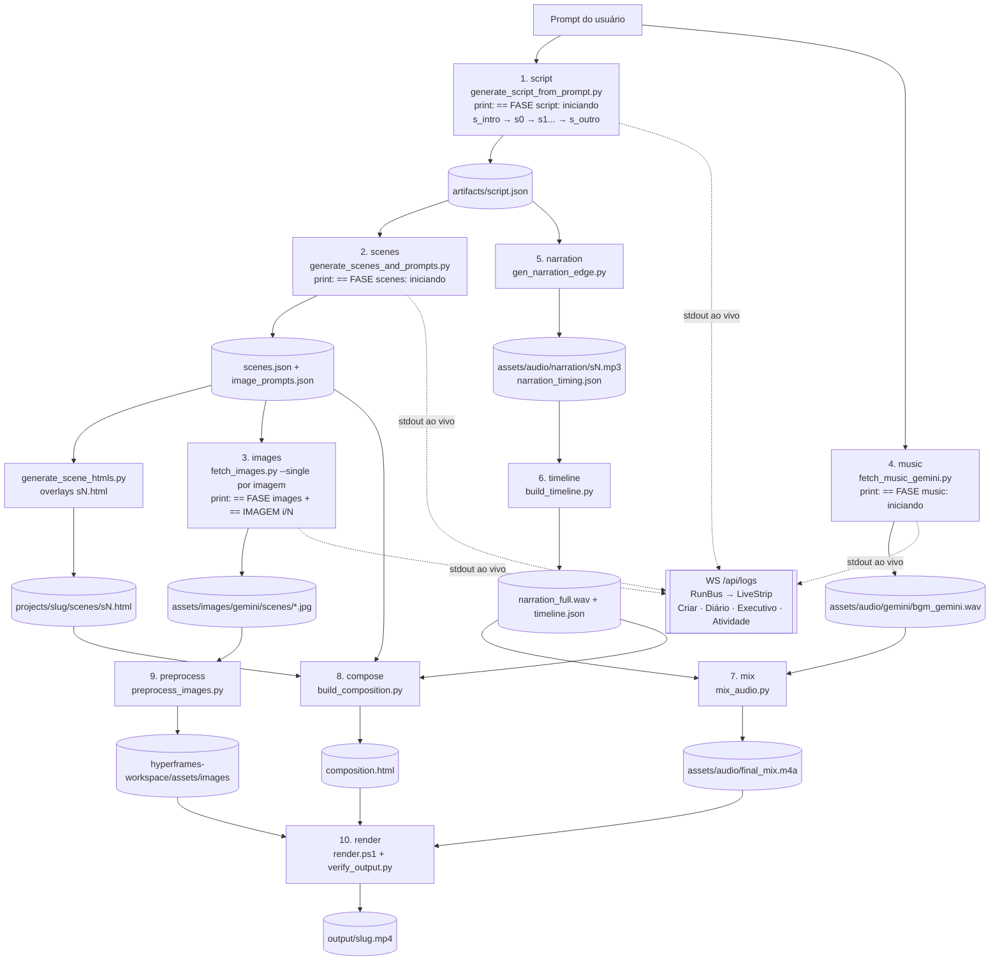
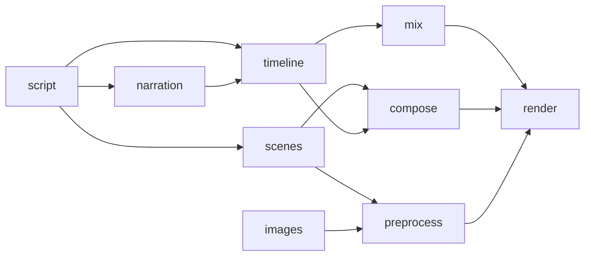
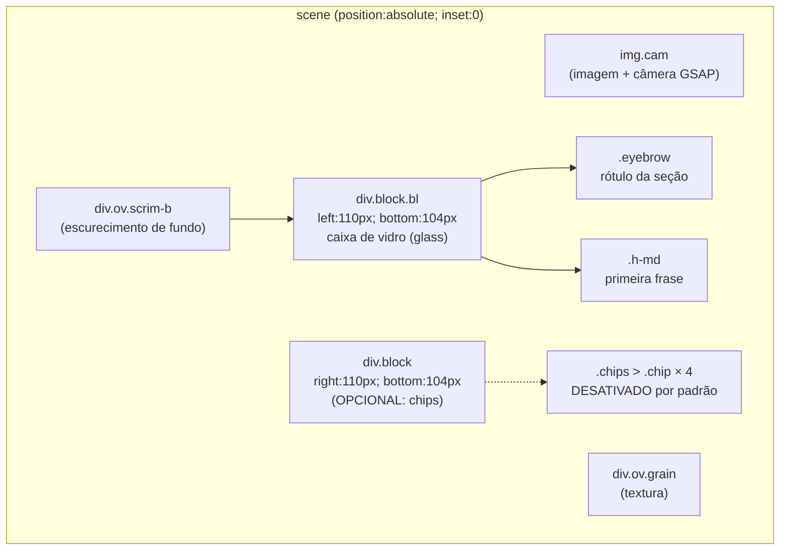
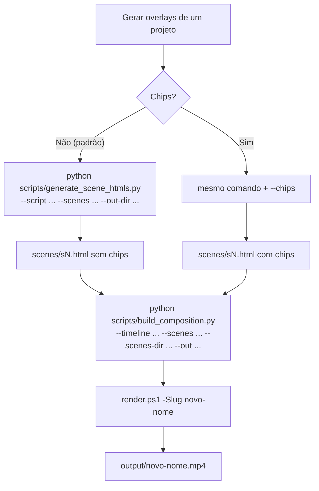
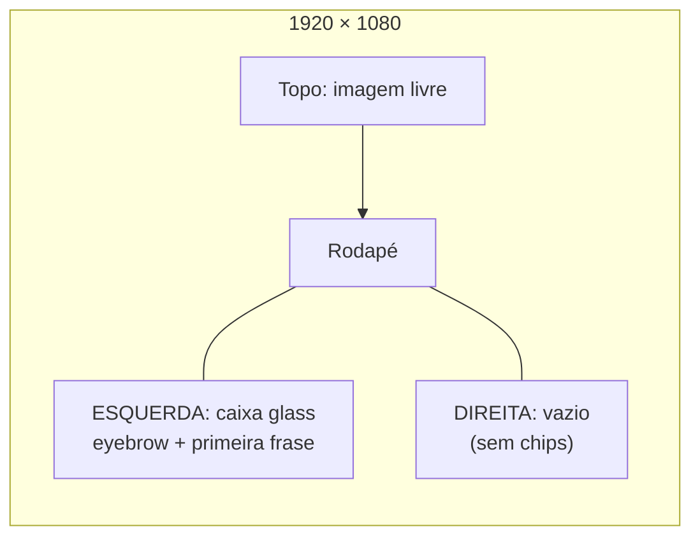
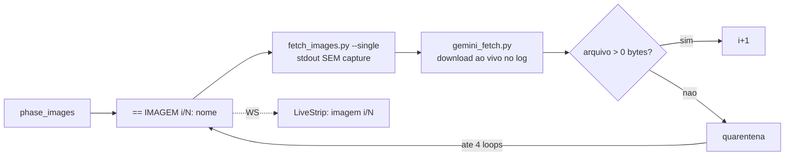
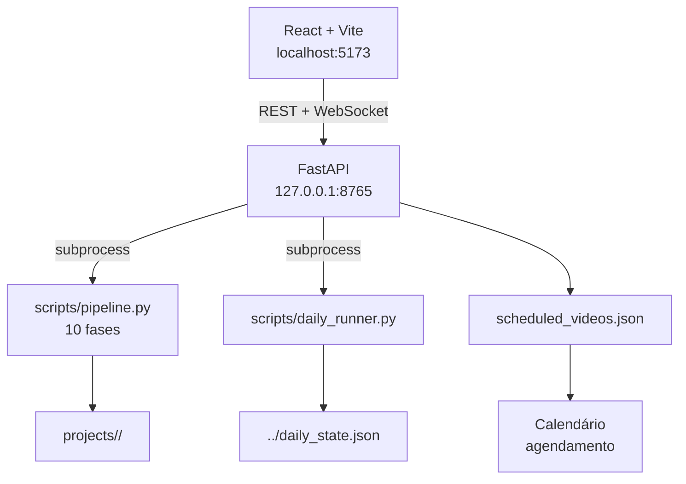
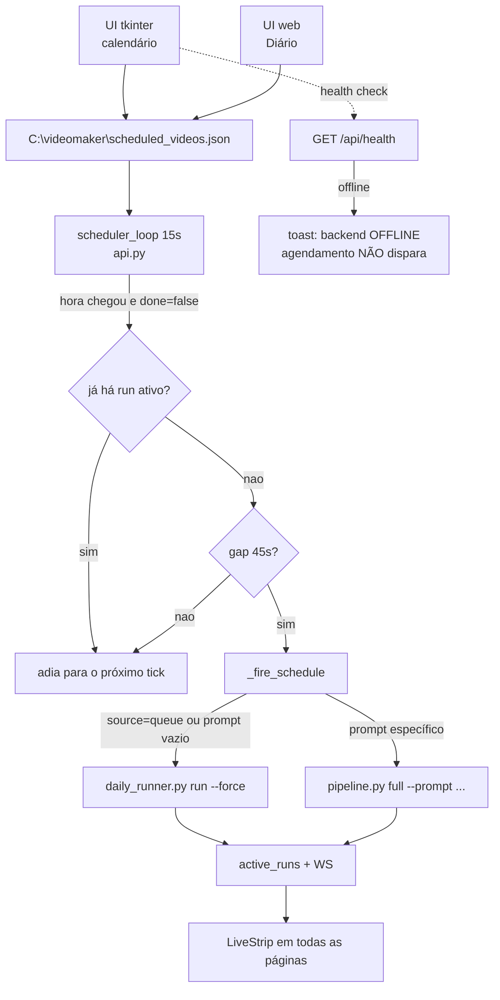
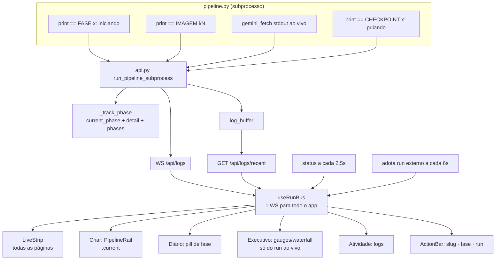
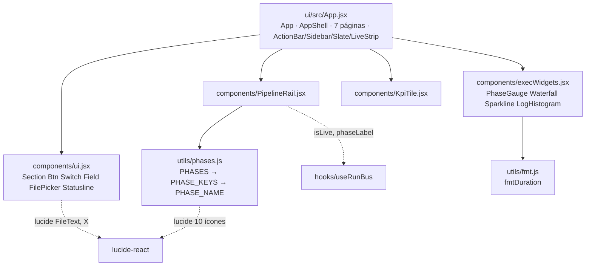

# Manual de Overlays e Grafos — Videomaker v3

> Documento de consulta rápida. Guarda **onde** cada elemento visual nasce, **como** o
> pipeline se conecta e **como** refazer/renderizar sem precisar investigar de novo.
> Última análise: 2026-11-05.
>
> **Novidades desta sessão:** correção de overlays duplicados (título aparecendo em cenas
> não-intro), correção de mix de áudio sendo copiado para o banco de músicas, saudação do
> canal atualizada ("Olá amiguinhos e amiguinhas!"), upload do YouTube com idioma pt-BR,
> descrição automática completa e thumbnail automática.

---

## 1. Resumo do problema e da correção

**Sintoma:** durante cada cena apareciam 4 palavras-chave em "chips" no canto
inferior direito (ex.: `FALA · GALERA · QUEM · AQUI`). A caixa de texto da
esquerda é boa; os chips poluíam a tela.

**Causa raiz:** `scripts/generate_scene_htmls.py` gerava os chips automaticamente
a partir das primeiras palavras do texto da seção e os injetava em
`projects/<slug>/scenes/sN.html`. Depois `scripts/build_composition.py` embutia
esses overlays no `composition.html`.

**Correção aplicada:** os chips passaram a ser **desativados por padrão**. Só são
gerados com a flag explícita `--chips`.

**Entregas geradas (sem chips, sem sobrescrever os originais):**

```
projects/video-educativo-sobre-banho-em-cachorro/output/
  video-educativo-sobre-banho-em-cachorro.mp4            (original, com chips)
  video-educativo-sobre-banho-em-cachorro-sem-chips.mp4  (nova versão, 255,10 s)

projects/teste-10s-dentes-cachorro/output/
  teste-10s-dentes-cachorro.mp4                          (original, com chips)
  teste-10s-dentes-cachorro-sem-chips.mp4                (nova versão, 9,40 s)
```

As composições originais foram preservadas em `composition-com-chips.html` em
cada projeto.

---

## 1.5. Gotcha crítico: timeline é reescrita após narração

A fase `narration` gera `narration_timing.json` com durações estimadas. A fase
`timeline` (`build_timeline.py`) normaliza os MP3s, concatena com pausas e **reescreve**
`artifacts/timeline.json` com **durações reais** (start/end por seção). Isso altera o
`total` do vídeo.

**Consequência obrigatória:** sempre que `narration` ou `timeline` muda, a fase
`compose` (`build_composition.py`) **deve ser re-executada**, pois ela lê
`timeline.json` para montar o `composition.html`. Se você renderizar sem reconstruir a
composição após mudar a narração, o vídeo ficará com duração incorreta e `delta != 0`
(áudio e vídeo desencontrados).

Fluxo correto quando só a narração muda:
```
narration → timeline (reescreve timeline.json) → compose (reconstrói composition.html) → render
```
O grafo de dependências em `scripts/pipeline.py:414` já modela isso (`narration → timeline → compose → render`).

---

## 1.6. Caminho das imagens

O `build_composition.py` referencia as imagens como `src="assets/images/<nome>.jpg"`
(raiz de `assets/images/`, **não** `assets/images/scenes/`). O `fetch_images.py` baixa
para `assets/images/gemini/scenes/`; a fase `preprocess` (`preprocess_images.py`) copia
para o workspace do HyperFrames. Ao montar a composição localmente (`--out`), garanta que
os JPEGs estejam em `projects/<slug>/assets/images/` (raiz), não apenas na subpasta
`scenes/`.

---

## 1.7. Voz recomendada para vídeos engraçados

Voz neural brasileira local (Edge-TTS, sem API, sem tokens):

```
--voice pt-BR-ThalitaNeural --rate +15% --pitch +10Hz
```

`ThalitaNeural` é jovem, sorridente e empolgada. `+15%` de rate e `+10Hz` de pitch deixam
a narração mais ágil e divertida, ideal para comédia. Risadas escritas ("Hahaha!") são
removidas automaticamente pelo `gen_narration_edge.py` (soam falsas na voz neural).

---

## 1.8. Música procedural (fallback sem API)

Quando a trilha do Gemini não está disponível, use o gerador procedural local:

```
python scripts/gen_music_procedural.py --proj <slug> --provider procedural
python scripts/mix_audio.py --proj <slug> --provider procedural
```

Gera `assets/audio/music/bgm_procedural.wav` com arranjo de ukulele/marimba/pizzicato,

---

## 1.9. Ficha canônica de Frida e Luna (fonte única de verdade)

Sempre que o assunto do vídeo envolver Frida e Luna, ESTA ficha é injetada
automaticamente nos prompts — tanto no briefing dos roteiros (`prompt_gen.py`,
`DEFAULT_CHANNEL_STYLE`) quanto nos prompts de IMAGEM enviados ao Gemini
(`generate_scenes_and_prompts.py`, `FRIDA_LUNA_DESC` → `artifacts/image_prompts.json`
→ `fetch_images.py` → `gemini_fetch.py`, que envia o prompt literal):

```
LUNA  — salsicha (dachshund) fêmea, pelagem marrom-chocolate, pelo curto, liso e rente (padrão da raça);
        focinho coberto pelo mesmo pelo curto, com apenas alguns pelinhos brancos discretos no contorno;
        não peluda, sem pelos longos, sem barba. MUITO briguenta, ciumenta e possessiva;
        apesar de pequena (~10 kg) é QUEM MANDA no par. Apelido carinhoso: Luninha.
FRIDA — buldogue inglesa fêmea grande (~30 kg), pelagem AMARELA-FAWN (cor
        clássica dos buldogues), super tranquila, pacata e preguiçosa; obedece
        à Luna em tudo, dócil e submissa. (A pequena comanda; a gigante obedece.)
        Apelido carinhoso: Fridóca.
```

- **Detecção automática:** `is_frida_luna_script()` escaneia preset + título +
  textos das seções (`frida`, `luna`, `bulldog/buldogue`, `salsicha/dachshund`).
- **NÃO fazer:** introduzir "brown bulldog" ou cor marrom para a Frida
  (o hardcode antigo foi removido de generate_scenes_and_prompts.py).
- Para atualizar a ficha no futuro, edite os DOIS pontos:
  `FRIDA_LUNA_DESC` em generate_scenes_and_prompts.py (imagens) e
  `DEFAULT_CHANNEL_STYLE` em prompt_gen.py (roteiros).
offline e custo zero.

---

## 1.9. Re-render rápido (-SkipCheck)

O `scripts/render.ps1` aceita `-SkipCheck` para pular o `npm run check` (lint + layout +
motion + contraste). Use apenas quando já validou a composição anteriormente e quer
re-renderizar rápido:

```
.\scripts\render.ps1 -SkipCheck -ProjectDir <proj> -Slug <novo-slug> -CompFile ... -MixFile ...
```

---

## 1.10. Correções críticas de qualidade (v3.8)

### 1.10.1. Overlay de título não duplica em cenas não-intro

**Problema:** cenas `s2` ("Apresentação da Fridoca") e `s3` ("Apresentação da Luna")
estavam recebendo o overlay de título animado (badge + título + corpo), porque a função
`is_intro_section()` em `scripts/generate_scene_htmls.py` usava `"apresent" in label`
para detectar a cena de abertura. Qualquer rótulo com a palavra "Apresentação" ativava
o overlay.

**Correção:** `is_intro_section()` agora retorna `True` **apenas** para `sid == "s0"`.
O rótulo da cena não é mais considerado.

**Arquivo alterado:** `scripts/generate_scene_htmls.py` — função `is_intro_section()`.

**Como verificar:** após regenerar overlays, apenas `scenes/s0.html` deve conter o
bloco `<div class="block tc"...>` com o título. Todas as outras `sN.html` devem ficar
vazias (sem overlay de texto).

---

### 1.10.2. Mix de narção não entra no banco de músicas

**Problema:** `scripts/sync_bancos.py` copiava `final_mix.m4a` (que contém narração +
música) para `C:\videomaker\banco de músicas\`. Quando o pipeline escolhia uma música
do banco, podia pegar um mix que já tinha narração, resultando em "narração sobre
narração".

**Correção:** `sync_bancos.py` copia apenas arquivos `.wav` da pasta `gemini/`
(trilha bruta). O `final_mix.m4a` **não** é mais copiado para o banco de músicas.

**Arquivo alterado:** `scripts/sync_bancos.py` — função `sync_project()`.

**Arquivos `_mix*` já copiados indevidamente foram removidos do banco.**

---

### 1.10.2. Saudação do canal (s0)

**Texto atual (padrão):** `"Olá amiguinhos e amiguinhas! Tudo bem com vocês? Que legal
ter vocês aqui com a gente! Hoje a gente vai falar de <assunto>."`

**Arquivos alterados:**
- `scripts/generate_script_from_prompt.py` — template da seção `s0` e regra de abertura.
- `scripts/narration_contract.py` — constante `INTRO_PREFIX` e regex `_INTRO_RE`.

Não há vírgula após "Olá", evitando leitura robotizada pelo narrador.

---

### 1.10.4. Upload do YouTube (metadados completos, tudo automático por padrão)

A fase `youtube` e o `scripts/youtube_upload.py` enviam o vídeo com **todos os parâmetros preenchidos automaticamente**. Não é necessário passar nenhum argumento na linha de comando. Basta:

```powershell
python scripts/youtube_upload.py --video projects/<slug>/output/<slug>.mp4
```

| Campo | Valor padrão | Como sobrescrever |
|-------|-------------|-------------------|
| Título | Do `artifacts/script.json` (título do roteiro) | `--titulo "..."` |
| Descrição | Automática: título + tema + "gerado por IA" + "sem promoção paga" + "Português do Brasil" + "feito para crianças" + hashtags | `--description "..."` |
| Tags | `cachorro,animacao,infantil,frida,luna` | `--tags "..."` |
| Categoria | 24 (Entretenimento) | `--category "..."` |
| Idioma padrão | `pt-BR` | `--default-language "..."` |
| Idioma do áudio | `pt-BR` | `--default-audio-language "..."` |
| Feito para crianças | Sim (ativado por padrão) | `--nao-kids` para desativar |
| Privacidade | `public` | `--privacy private\|unlisted` |
| Thumbnail | Procura `thumb.jpg` / `thumbnail.jpg` / `thumb.png` / `thumbnail.png` na pasta do projeto; senão a primeira imagem da cena em `assets/images/gemini/scenes/` | `--thumbnail "caminho/para/imagem.jpg"` |

**Descrição automática gerada:**
```
<Título>

<Tema>

Vídeo gerado por inteligência artificial (IA).
Não contém promoção paga.
Idioma da narração e das legendas: Português do Brasil.
Conteúdo infantil (feito para crianças).

#cachorro #animacao #infantil #frida #luna #desenhoanimado
```

**Arquivos alterados:** `scripts/youtube_upload.py` (parâmetros de idioma, defaults automáticos, busca de thumbnail),
`scripts/pipeline.py` (`phase_youtube` e `publish_to_youtube` — delegam para o `youtube_upload.py` que cuida dos defaults).

---

### 1.10.5. Nova seção de introdução (s_intro) — saudação com gancho

A partir desta versão, o roteiro inclui uma **nova seção s_intro** que vem **antes** da saudação s0. Seu objetivo é despertar curiosidade nos primeiros segundos do vídeo.

| Campo | Valor |
|-------|-------|
| id | `s_intro` |
| label | `Introdução do Vídeo` |
| texto | Gerado pelo Gemini com base no assunto. Exemplo: "E se um cachorro pudesse ir para a escola? Já imaginou como será?" |
| delivery_cues | pace: brisk, energy: curioso e empolgado |

**Regras do contrato:**
- A primeira seção é SEMPRE a `s_intro`
- A segunda seção é SEMPRE a `s0` (saudação "Olá amiguinhos e amiguinhas!")
- A última seção é SEMPRE a `s_outro` (agradecimento)

**Arquivos alterados:**
- `scripts/generate_script_from_prompt.py` — template SYSTEM atualizado para instruir o Gemini a criar ganchos inteligentes
- `scripts/narration_contract.py` — função `apply_contract()` agora insere `s_intro` no início das seções; `build_hook()` gera fallback se o Gemini não criar; `validate_contract()` valida a ordem s_intro → s0 → ... → s_outro

---


## 2. Inventário dos projetos

| Projeto | Conteúdo | Vídeo |
|---|---|---|
| `projects/video-educativo-sobre-banho-em-cachorro` | 12 seções (s1..s10, s4b, s8b), ~255 s | original + variante sem chips |
| `projects/teste-10s-dentes-cachorro` | 1 seção (s1), ~10 s | original + variante sem chips |

> `scripts/scenes/s*.html` é um conjunto antigo de overlays de outro tema
> (buldogue). Não entra no render de um projeto; o pipeline usa
> `projects/<slug>/scenes/`.

---

## 3. Grafo do pipeline (10 fases)



Cada fase imprime `== FASE <nome>: iniciando` antes de rodar. A fase `images`
emite `== IMAGEM i/N: <nome>` e o stdout do `gemini_fetch` **não é mais capturado**
(streaming direto para o log). Checkpoints válidos imprimem
`== CHECKPOINT <nome>: feito ... -> pulando` e **não** emitem `FASE ... iniciando`.

---

## 4. Grafo de dependências (invalidação em cascata)

Quando uma fase é refeita, as fases abaixo dela são marcadas como pendentes no
`project.json` (a cascata está em `DEPS`, `scripts/pipeline.py:414`).



Leitura prática:

- Mexeu no texto/roteiro → `reset --phase script` → `full` refaz o resto.
- Mexeu nos overlays → `reset --phase scenes` ou `compose` → `full`.
- Mexeu só no visual dos overlays → `reset --phase compose` → `full`.
- Quer só uma variante sem tocar no original → renderize com outro `-Slug`
  (ver §7).

---

## 5. Anatomia do overlay de cena



**Estrutura HTML gerada (sem chips — padrão atual):**

```html
<div class="ov scrim-b"></div>
<div class="block bl" id="s1-title" style="max-width:720px">
  <div class="glass" data-anim="rise" data-at="0.02">
    <div class="eyebrow">Introdução ao Caos</div>
    <div class="h-md" style="margin-top:10px">Fala, galera!</div>
  </div>
</div>
```

**Com `--chips` (comportamento antigo, opcional):**

```html
<div class="block" style="right:110px;bottom:104px;max-width:620px;text-align:right">
  <div class="chips">
    <div class="chip" data-anim="pop" data-at="0.12"><span class="dot"></span>FALA</div>
    ...
  </div>
</div>
```

### Onde exatamente os chips eram criados

| Local | Papel |
|---|---|
| `scripts/generate_scene_htmls.py:42` `chips_from()` | escolhe as 4 primeiras palavras com 4+ letras |
| `scripts/generate_scene_htmls.py:56` `render_section()` | monta o bloco `.chips` (agora só se `with_chips=True`) |
| `scripts/generate_scene_htmls.py:91` `--chips` | flag que reativa (default: desligado) |
| `projects/<slug>/scenes/sN.html` | overlays persistidos de cada cena |
| `scripts/build_composition.py:248` | lê os overlays e injeta na composição |
| `projects/<slug>/composition.html` | HTML final do HyperFrames com os overlays |

O CSS `.chips`/`.chip` continua em `build_composition.py:59` (inofensivo); sem o
HTML dos chips, nada aparece.

---

## 6. Fluxo de decisão do overlay



---

## 7. Comandos operacionais

### 7.1 Regenerar overlays sem chips (padrão)

```powershell
python scripts/generate_scene_htmls.py `
  --script projects\<slug>\artifacts\script.json `
  --scenes projects\<slug>\artifacts\scenes.json `
  --out-dir projects\<slug>\scenes
```

### 7.2 Reativar chips (só se pedido)

```powershell
python scripts/generate_scene_htmls.py ... --chips
```

### 7.3 Rebuild da composição (sem chips)

```powershell
python scripts/build_composition.py `
  --timeline projects\<slug>\artifacts\timeline.json `
  --scenes projects\<slug>\artifacts\scenes.json `
  --scenes-dir projects\<slug>\scenes `
  --out projects\<slug>\composition.html
```

### 7.4 Render de uma nova versão sem sobrescrever a antiga

```powershell
$proj = "C:\videomaker\projects\video-educativo-sobre-banho-em-cachorro"
.\scripts\render.ps1 `
  -ProjectDir $proj `
  -Slug "video-educativo-sobre-banho-em-cachorro-sem-chips" `
  -CompFile "$proj\composition.html" `
  -MixFile "$proj\assets\audio\final_mix.m4a"
```

O `-Slug` diferente grava `output/<slug>.mp4` sem tocar no vídeo original.

### 7.5 Conferir um frame

```powershell
$env:PATH = "C:\videomaker\ffmpeg\bin;" + $env:PATH
ffmpeg -y -ss 6 -i "$proj\output\video-...-sem-chips.mp4" -frames:v 1 frame.jpg
```

### 7.6 Verificação automática

```powershell
python scripts/verify_output.py --proj $proj
# Esperado: STATUS OK, 1920x1080 @30, ~-14 LUFS, <= -1.5 dBTP
```

### 7.7 Recompor composição após mudar narração/timeline

```powershell
# 1. Narração já gerada (fase narration feita)
# 2. Rebuild timeline com durações reais
python scripts/build_timeline.py --proj projects\<slug>
# 3. Rebuild composição com a timeline nova (obrigatório!)
python scripts/build_composition.py `
  --timeline projects\<slug>\artifacts\timeline.json `
  --scenes projects\<slug>\artifacts\scenes.json `
  --scenes-dir projects\<slug>\scenes `
  --out projects\<slug>\composition.html
# 4. Render
.\scripts\render.ps1 -ProjectDir $proj -Slug "<slug>-v2" -CompFile ... -MixFile ...
```

### 7.8 Voz engraçada (narração)

```powershell
python scripts\gen_narration_edge.py --proj projects\<slug> `
  --voice pt-BR-ThalitaNeural --rate +15% --pitch +10Hz --workers 4
```

### 7.9 Música procedural (fallback sem API)

```powershell
python scripts\gen_music_procedural.py --proj projects\<slug>
python scripts\mix_audio.py --proj projects\<slug> --provider procedural
```

### 7.10 Re-render rápido sem lint

```powershell
.\scripts\render.ps1 -SkipCheck `
  -ProjectDir $proj `
  -Slug "<slug>-variante" `
  -CompFile "$proj\composition.html" `
  -MixFile "$proj\assets\audio\final_mix.m4a"
```


---

## 8. Padrão visual oficial (a partir de agora)



- **Esquerda:** caixa `.glass` com rótulo (`.eyebrow`) + primeira frase (`.h-md`).
- **Direita:** intencionalmente vazia; não gerar chips de palavras.
- **Centro:** preservado para o personagem principal.
- Se um dia precisar de palavras-chave, usar `--chips` **apenas em projeto
  isolado**, nunca como padrão.

---

## 9. Checklist de QA do overlay

- [ ] `scenes/sN.html` sem `class="chip"` (quando o padrão é sem chips).
- [ ] `composition.html` sem `class="chips"`/`class="chip"`.
- [ ] Texto na esquerda legível e sem cobrir o rosto do personagem.
- [ ] `verify_output.py` retorna `STATUS OK`.
- [ ] Frame conferido em início/meio/fim do vídeo.

---

## 10. Solução de problemas
| Sintoma | Causa / solução |
|---|---|
| Chips voltaram | `generate_scene_htmls.py` foi chamado com `--chips`, ou o `scenes/sN.html` antigo não foi regenerado |
| Chips aparecem só em algumas cenas | overlays antigos não regenerados naquele projeto; rode §7.1 |
| `composition.html` ainda tem chips | rode §7.3 depois de regenerar os overlays |
| Render sobrescreveu o vídeo original | use `-Slug` diferente (§7.4) |
| Quer o vídeo com chips de volta | renderize a partir de `composition-com-chips.html` com outro `-Slug` |
| `NameError: name 'sp' is not defined` | erro corrigido em `scripts/pipeline.py` (`sp.add_argument` → `ap.add_argument` fora de `common()`) |
| `daily_runner.py` gera prompt desconexo | agora ele embute `prompt_gen.build_script_brief()` com preset "Frida e Luna" |

---

## 11. Executor diário (daily_runner.py) + prompt_gen.py

O `daily_runner.py` consome a fila `scripts/topics.txt` e gera um vídeo por dia. Desde a
última atualização, ele **embute o `prompt_gen.py`** para gerar o brief de roteiro no
formato correto, com o preset "Frida e Luna" (Bulldog + Salsicha, estilo Pixar, voz
feminina, tom divertido).

### Como o prompt é gerado

1. `daily_runner.build_prompt(topic, cfg)` chama `prompt_gen.episode_params(topic)`,
   que retorna parâmetros padronizados (tema, objetivo "Entreter", conteúdo "Pets",
   estilo "Pixar", preset "Frida e Luna").
2. Em seguida chama `prompt_gen.build_script_brief(p)`, que produz um briefing compacto
   com a fórmula do canal (gancho, promessa, desenvolvimento, duas camadas, clímax,
   final) + as regras do canal "Frida e Luna" (personagens fixas, tom caloroso, etc.).
3. Esse brief é passado ao `pipeline.py full --prompt "<brief>" --slug <slug>`, que o
   envia ao Gemini WEB para gerar o `artifacts/script.json`.

Exemplo de prompt gerado (tema: "A Frida e a Luna descobrem que o aspirador é um monstro"):

```
Crie o roteiro de um vídeo animado para o YouTube.

TÍTULO: A Frida e a Luna descobrem que o aspirador de pó é um monstro
TEMA: A Frida e a Luna descobrem que o aspirador de pó é um monstro
OBJETIVO: Entreter
PÚBLICO-ALVO: Família (crianças e adultos)
DURAÇÃO: cerca de 10 minutos
TIPO DE CONTEÚDO: Pets
ESTILO VISUAL: Pixar
NARRAÇÃO: Feminina

ESTRUTURA EM 3 ATOS:
1. Gancho forte nos primeiros 10 segundos e contexto.
2. Desenvolvimento com viradas e mudanças de cena frequentes.
3. Clímax, lição final e chamada para ação (CTA).

REGRAS DO CANAL "FRIDA E LUNA"
Protagonistas fixas (o mundo é visto do ponto de vista dos cachorros; sem humanos em cena):
- Luna: salsicha marrom com pelinhos brancos no fucinho, muito briguenta,
  ciumenta e possessiva; pequena (~10 kg) mas é QUEM MANDA no par.
  Apelido carinhoso: Luninha. ...
- Frida: buldogue inglesa amarela-fawn (~30 kg), super tranquila, pacata e
  preguiçosa; obedece à Luna em tudo. Apelido carinhoso: Fridóca. ...
...
```

### Comandos do executor diário

| Comando | Efeito |
|---|---|
| `python scripts/daily_runner.py status` | Fila, feitos, pendentes, falhos, previsão de término |
| `python scripts/daily_runner.py run` | Gera + envia o próximo episódio (1× por dia) |
| `python scripts/daily_runner.py run --dry-run` | Mostra o que faria, sem rodar |
| `python scripts/daily_runner.py run --no-upload` | Gera o vídeo mas não envia ao YouTube |
| `python scripts/daily_runner.py run --force` | Roda mesmo que hoje já tenha rodado |
| `python scripts/daily_runner.py unpause --requeue-failed` | Libera a fila e recoloca assuntos falhos |

### Arquivos do executor diário

| Arquivo | Papel |
|---|---|
| `scripts/topics.txt` | Fila de assuntos (1 por linha, acrescente no final) |
| `scripts/prompt_template.txt` | Modelo legado (mantido para compatibilidade; não é mais usado pelo build_prompt) |
| `scripts/daily_config.json` | Horário, privacidade, tags, tentativas... (criado na 1ª execução) |
| `../daily_state.json` | O que já foi feito / pendente / falhou |
| `../logs/daily-AAAA-MM-DD.log` | Log de execução diária |

---

## 12. Ordem Música → Imagens + Quarentena de Imagens

Desde esta atualização, o pipeline executa a fase **music ANTES de images** (não em paralelo)
para evitar conflito do Chrome/gemini_fetch entre a geração da trilha e a geração de imagens.
Se ambas as fases estão no plano, o pipeline roda `music` de forma sequencial e só depois
inicia `images`.

### Loop de quarentena (até 4 tentativas)

A fase `images` agora processa **uma imagem por vez** via `fetch_images.py --single <nome>`.
Imagens que falharem (rc != 0 ou arquivo com 0 bytes) vão para uma **quarentena**.
Após processar todas as imagens, o pipeline faz até **4 loops** na quarentena, tentando
novamente as que falharam. Se após o 4º loop ainda houver imagens falhando, o processo
encerra com erro.

Fluxo:
```
images (1ª passagem) → quarentena loop 1 → quarentena loop 2 → quarentena loop 3 → quarentena loop 4
   ↓                                              ↓
sucesso                                        ERRO: imagens em quarentena falharam
```

### Telemetria da fase images (v3.4)

Antes desta correção, `phase_images` usava `subprocess.run(..., capture_output=True)`
e **não** emitia `FASE images`. O log/painel ficavam presos em "cenas" enquanto o
gemini_fetch baixava as fotos. Agora:

| Evento no stdout | Efeito na UI |
|------------------|--------------|
| `== FASE images: N imagem(ns) via Gemini web` | fase = images |
| `== IMAGEM i/N: <nome>` | detalhe = `imagem i/N` (LiveStrip, rail, executivo) |
| `== QUARENTENA loop k/4` | detalhe = `quarentena de imagens` |
| stdout do `gemini_fetch` | **streaming direto** (sem capture) para o log ao vivo |
| `[nome] OK` / `[nome] FALHA` | fim daquela imagem |



### Comandos relacionados

```powershell
# Processar UNA imagem individualmente (modo single)
python scripts\fetch_images.py --proj <slug> --single s4_barking --wait 240 --pause 8

# Pipeline completo com música primeiro e quarentena de imagens
python scripts\pipeline.py full --prompt "<brief>" --slug <slug>
```

---

## 13. Arquivos alterados/gerados nesta correção

```
scripts/generate_scene_htmls.py                     chips desativados por padrão (--chips opcional)
scripts/pipeline.py                                 --skip-check; corrigido sp→ap em common(); música antes de imagens; quarentena de imagens (4 loops)
scripts/pipeline_ui.py                              checkbox "Pular lint no render"
scripts/fetch_images.py                             modo --single; FORCED_KIND imagem; _garantir_modo_imagem()
scripts/generate_scenes_and_prompts.py              FRIDA_LUNA_DESC injetado em prompts de imagem
scripts/daily_runner.py                             embute prompt_gen.build_script_brief()
scripts/prompt_gen.py                               já existia; agora usado pelo daily_runner
projects/video-engracado-sobre-buldogue-ingles-divertido/   novo projeto completo (sem chips)
projects/video-engracado-sobre-buldogue-ingles-divertido/output/video-engracado-sobre-buldogue-ingles-divertido.mp4  (250,83 s, STATUS OK)
MANUAL_GRAFOS.md                                    este documento
```

---

## 14. fetch_images.py — modo imagem sempre forçado

O `scripts/fetch_images.py` **roda SEMPRE em modo gerador de IMAGEM** do Gemini (`--kind image`). Nunca gera áudio ou vídeo.

- A constante `FORCED_KIND = "image"` garante que `--kind image` esteja sempre presente no comando.
- A função `_garantir_modo_imagem()` remove qualquer `--kind` anterior e reinsere `--kind image` logo após o caminho da skill, impedindo sobrescrita acidental.
- Isso vale tanto para o modo lote (`--only`) quanto para o modo individual (`--single <nome>`).

Comando:
```powershell
python scripts\fetch_images.py --proj <slug> --single s4_barking --wait 240 --pause 8
```

---

## 15. generate_scenes_and_prompts.py — consistência dos personagens Frida e Luna

Quando o roteiro é do canal **Frida e Luna** (detectado automaticamente via `preset`, `content_type`, `style_notes` ou `title` contendo "frida", "luna", "bulldog", "buldogue", "salsicha" ou "dachshund"), **todos os prompts de imagem começam com a descrição fixa dos personagens (sem menção a marcas de estúdio, para evitar bloqueios de IP)**:

```
Ficha canônica (seção 1.9) injetada como prefixo de CADA prompt de imagem:
Luna: salsicha fêmea, pelagem marrom-chocolate, pelo curto, liso e rente (padrão da raça);
focinho coberto pelo mesmo pelo curto, com apenas alguns pelinhos brancos discretos no contorno;
não peluda, sem pelos longos, sem barba. MUITO briguenta, ciumenta e possessiva;
apesar de pequena (~10 kg) é QUEM MANDA no par. Apelido carinhoso: Luninha.
Frida: buldogue inglesa fêmea grande (~30 kg), pelagem amarela-fawn (cor clássica
dos buldogues), super tranquila, pacata e preguiçosa; obedece à Luna em tudo,
dócil e submissa. (A pequena comanda; a gigante obedece.) Apelido carinhoso: Fridóca.
+ animação 3D cinematográfica de alta qualidade, visual de longa-metragem de animação familiar,
cores quentes, iluminação suave, expressões faciais exageradas e carismáticas;
mesma aparência em todas as cenas.
```

Isso garante que a IA do Gemini gere imagens com os mesmos personagens em todas as cenas, mantendo a consistência visual ao longo do vídeo.

A detecção é feita por `is_frida_luna_script()` em `generate_scenes_and_prompts.py`. Quando verdadeiro, o prefixo `FRIDA_LUNA_DESC` é pré-pendido a cada prompt de imagem.

---

## 16. Arquivos alterados/gerados nesta correção

```
scripts/generate_scene_htmls.py                     chips desativados por padrão (--chips opcional)
scripts/pipeline.py                                 --skip-check; corrigido sp→ap em common(); música antes de imagens; quarentena de imagens (4 loops)
scripts/pipeline_ui.py                              checkbox "Pular lint no render"
scripts/fetch_images.py                             modo --single; FORCED_KIND imagem; _garantir_modo_imagem()
scripts/generate_scenes_and_prompts.py              FRIDA_LUNA_DESC injetado em prompts de imagem
scripts/daily_runner.py                             embute prompt_gen.build_script_brief()
scripts/prompt_gen.py                               já existia; agora usado pelo daily_runner
projects/video-engracado-sobre-buldogue-ingles-divertido/   novo projeto completo (sem chips)
projects/video-engracado-sobre-buldogue-ingles-divertido/output/video-engracado-sobre-buldogue-ingles-divertido.mp4  (250,83 s, STATUS OK)
MANUAL_GRAFOS.md                                    este documento
```

---

## 17. Interface Premium — scripts/pipeline_ui.py

A UI foi reescrita como uma aplicação **super premium**, com design digno de prêmio de melhor interface de produção de vídeo.

### 17.1. Estrutura de navegação

| Página | Função |
|---|---|
| Criar | Prompt, duração, etapas, voz e geração do vídeo |
| Publicar | Envio ao YouTube com título, descrição, tags, privacidade, **atualizar metadados de vídeo existente** |
| Diário | Executor diário: fila de tópicos, run, dry-run, unpause |
| Atividade | Log de execução em tempo real com cópia e limpeza |
| Ajustes | Tema, zoom, atalhos de teclado, configurações de pipeline e YouTube |

### 17.2. Zoom da interface

O zoom é global e afeta toda a interface instantaneamente:

| Ação | Tecla | Efeito |
|---|---|---|
| Aumentar | Ctrl + + (teclado numérico) | Próximo nível de zoom |
| Diminuir | Ctrl + - (teclado numérico) | Nível anterior |
| Resetar | Ctrl + 0 (teclado numérico) | Volta para 100% |

Níveis disponíveis: 75% · 100% · 125% · 150%. O zoom é persistido em scripts/pipeline_ui_settings.json.

### 17.3. Daily Runner integrado

A página **Diário** consolida o daily_runner.py dentro da UI:

- Status da fila: mostra feitos, pendentes, falhos e previsão de término
- Executar agora: roda o próximo episódio (daily_runner.py run)
- Simulação: mostra o que faria sem rodar nada (--dry-run)
- Não enviar: gera o vídeo mas não faz upload (--no-upload)
- Forçar hoje: ignora o limite de um episódio por dia (--force)
- Liberar fila: remove pausa de segurança (unpause)
- Reenviar falhos: recoloca tópicos que falharam na fila (--requeue-failed)

O prompt de cada episódio é gerado automaticamente por prompt_gen.build_script_brief() com o preset Frida e Luna (personagens fixas, estilo Pixar, voz feminina, tom divertido).

### 17.4. Atalhos de teclado

| Tecla | Efeito |
|---|---|
| Ctrl + Enter | Gerar vídeo (página Criar) |
| Ctrl + + (num) | Aumentar zoom da UI |
| Ctrl + - (num) | Diminuir zoom da UI |
| Ctrl + 0 (num) | Resetar zoom para 100% |

### 17.5. Visual

- Cores: paleta índigo/violeta premium, semânticos refinados (ok/err/warn)
- Componentes: cards com vidro (glassmorphism), botões com estados hover/active/pressed, toggles animados, segmented controls, barras de progresso com modo indeterminado
- Tipografia: Segoe UI Variable / SF Pro, hierarquia de pesos (100–900), tamanhos escaláveis pelo zoom
- Micro-interações: pulse no status, hover nos chips de etapas, transições suaves de colapso
- Tema: claro/escuro automático detetado do SO, com override manual nos Ajustes

---

## 16. Arquivos alterados/gerados nesta correção

`
scripts/generate_scene_htmls.py                     chips desativados por padrão (--chips opcional)
scripts/pipeline.py                                 --skip-check; corrigido sp→ap em common(); música antes de imagens; quarentena de imagens (4 loops)
scripts/pipeline_ui.py                              UI premium com zoom, Daily Runner integrado, tema claro/escuro
scripts/fetch_images.py                             modo --single; FORCED_KIND imagem; _garantir_modo_imagem()
scripts/generate_scenes_and_prompts.py              FRIDA_LUNA_DESC injetado em prompts de imagem
scripts/daily_runner.py                             embute prompt_gen.build_script_brief()
scripts/prompt_gen.py                               já existia; agora usado pelo daily_runner
projects/video-engracado-sobre-buldogue-ingles-divertido/   novo projeto completo (sem chips)
projects/video-engracado-sobre-buldogue-ingles-divertido/output/video-engracado-sobre-buldogue-ingles-divertido.mp4  (250,83 s, STATUS OK)
MANUAL_GRAFOS.md                                    este documento
```

---

## 18. Descricoes dos personagens Frida e Luna (consistencia visual)

Para garantir que as imagens mantenham a mesma aparência de Frida e Luna em todas
as cenas, as descricoes abaixo são injetadas automaticamente no início de **todo**
prompt de imagem quando o roteiro é detectado como canal "Frida e Luna".

### LUNA (salsicha / dachshund fêmea)
- Salsicha fêmea, pelagem marrom-chocolate, pelo curto, liso e rente (padrão da raça).
- Tem uns 11 anos (aparência saudável, sem sinais exagerados de idade).
- Focinho coberto pelo mesmo pelo curto, com apenas alguns pelinhos brancos discretos no contorno.
- MUITO briguenta: late, reclama e cria caso por tudo.
- Ciumenta e possessiva: não deixa ninguém chegar perto do tutor.
- Quem manda no par é ela: a chefona da casa, apesar dos ~10 kg.
- Importante: NÃO peluda, sem pelos longos, sem barba, sem sobrancelhas longas (evita visual "wire-haired").
- Apelido carinhoso: Luninha (usar na narração com carinho, sem trocar o nome Luna).

### FRIDA (buldogue inglesa fêmea)
- Buldogue inglesa fêmea grande (~30 kg), pelagem amarela-fawn (a cor clássica dos buldogues).
- Super tranquila, pacata e preguiçosa (e super gulosa).
- Obedece à Luna em TUDO: dócil e submissa à chefona marrom.
- No fundo, as duas são amiguinhas.
- Apelido carinhoso: Fridóca (usar na narração com carinho, sem trocar o nome Frida).

### Como funciona
1. `scripts/daily_runner.py` monta o brief via `prompt_gen.build_script_brief()` com preset "Frida e Luna".
2. `scripts/generate_script_from_prompt.py` envia o brief ao Gemini WEB e gera `artifacts/script.json`.
3. `scripts/generate_scenes_and_prompts.py` lê o `script.json` e, via `is_frida_luna_script()`,
   detecta se o roteiro é Frida e Luna (checa preset, content_type, style_notes, title
   **e também os textos das seções**).
4. Se positivo, `FRIDA_LUNA_DESC` é pré-pendido a **todos** os prompts de imagem,
   garantindo que o Gemini gere as mesmas personagens em todas as cenas.

### Arquivos envolvidos
| Arquivo | Papel |
|---|---|
| `scripts/prompt_gen.py` | `DEFAULT_CHANNEL_STYLE` com as descricoes completas |
| `scripts/generate_scenes_and_prompts.py` | `FRIDA_LUNA_DESC` injetado em prompts de imagem; `is_frida_luna_script()` detecção |
| `scripts/build_topics.py` | Cabeçalho com as descricoes para referencia |
| `scripts/daily_runner.py` | Passa o brief com preset Frida e Luna ao pipeline |

---

## 19. Interface Web Premium — React + FastAPI + Vite

A interface foi reescrita como uma aplicação web moderna (React 18 + Vite + Tailwind CSS
+ Framer Motion), servida por um backend FastAPI (Python). A UI Tkinter anterior (`scripts/pipeline_ui.py`)
continua disponível, mas a experiência premium agora roda no navegador.

### 19.1. Arquitetura



### 19.2. Páginas da interface web

| Página | Função |
|---|---|
| Criar | Prompt, seleção visual das 10 fases do pipeline, duração, voz, promoção primeira imagem, upload YouTube |
| Publicar | Lista de projetos com vídeo gerado e botão de envio ao YouTube |
| Diário | **Calendário premium** para agendar vídeos por data/hora, vários por dia, recorrência (não repetir / diária / dias úteis / semanal) |
| Atividade | Logs em tempo real via WebSocket (`/api/logs`) |
| Ajustes | Tema claro/escuro/automático, zoom da interface |

### 19.3. Launcher

- `C:\videomaker\run_ui_premium.bat` (duplo-clique no Windows)
- `C:\videomaker\run_ui_premium.ps1` (alternativa PowerShell)

O launcher:
1. Verifica/instala dependências Python (`fastapi`, `uvicorn`, `websockets`, `pydantic`)
2. Verifica/instala dependências Node (`npm install`)
3. Inicia o backend FastAPI na porta 8765
4. Aguarda o endpoint `/api/health` responder
5. Inicia o frontend Vite na porta 5173

URLs após iniciar:
- Frontend: `http://localhost:5173`
- Backend: `http://127.0.0.1:8765`
- Documentação automática da API: `http://127.0.0.1:8765/docs`

---

## 20. Calendário de Agendamento de Vídeos

A página **Diário** inclui um calendário mensal visual (estilo scheduler do Windows/crontab do Linux, mas visual e premium).

### 20.1. O que permite

- Agendar um vídeo para uma data e hora específicas (`YYYY-MM-DD` + `HH:MM`)
- Vários vídeos no mesmo dia (cada um com seu horário e prompt)
- Recorrência: `none` | `daily` | `weekdays` | `weekly`
- Visualizar agendamentos por dia (dots coloridos nos dias com eventos)
- Marcar agendamentos como concluídos (✓)
- Remover agendamentos

### 20.2. Armazenamento — arquivo único

**Bug histórico (corrigido):** a UI tkinter gravava em `scripts/scheduled_videos.json`
e o scheduler do backend só lia `C:\videomaker\scheduled_videos.json`. Agendamentos
da tkinter eram **ignorados**. Agora os três (tkinter, web, scheduler) usam o mesmo
arquivo:

```
C:\videomaker\scheduled_videos.json
```

Na inicialização, o backend migra automaticamente agendamentos do caminho antigo
(`scripts/scheduled_videos.json` → renomeado para `.json.migrated`).

```json
{
  "scheduled_videos": [
    {
      "id": "a1b2c3d4",
      "date": "2026-11-05",
      "time": "09:00",
      "prompt": "Frida e Luna descobrem o aspirador",
      "source": "topic",
      "recurrence": "none",
      "weekdays": [],
      "upload": false,
      "created_at": "2026-11-02T10:00:00",
      "done": false
    }
  ]
}
```

Regras do scheduler:

- Tick de **15 s**.
- **Gap de 45 s** entre disparos.
- **Não inicia** se já há pipeline `running/starting/uploading` (Chrome CDP é single-user).
- Agendamento vencido (hora passou, `done: false`) dispara no próximo tick.
- `upload` só é `true` se marcado (tkinter grava `false` por padrão; web pode marcar).
- Tkinter avisa se o backend está offline (`GET /api/health`) — sem backend, **nada dispara**.

### 20.3. Endpoints da API para agendamento

| Método | Endpoint | Descrição |
|---|---|---|
| GET | `/api/schedules` | Lista todos os agendamentos |
| POST | `/api/schedules` | Cria um novo agendamento |
| DELETE | `/api/schedules/{id}` | Remove um agendamento |
| POST | `/api/schedules/{id}/done` | Marca como concluído |

### 20.4. Grafo do disparo



---

## 21. Correções de Estabilidade — UI Tkinter (`scripts/pipeline_ui.py`)

### 21.1. Encoding UTF-8 (acentos desconfigurados)

Adicionado `self.tk.call("encoding", "system", "utf-8")` na inicialização da janela `App.__init__`
(`pipeline_ui.py:680`), garantindo que caracteres como `ç`, `ã`, `é`, `ô` renderizem corretamente
em vez de aparecerem como `�` ou mojibake.

### 21.2. Erro `invalid command name` no Tkinter

O `trace_add("write", ...)` dos widgets `Switch`, `Toggle`, `Segmented`, `Slider` e `ProgressBar`
chamava `_draw()` mesmo após o widget ser destruído (troca de página), gerando `_tkinter.TclError:
invalid command name`. Corrigido adicionando `if not self.winfo_exists(): return` no início de
todos os métodos `_draw()` dessas classes.

---

## 22. Miniatura / Primeira Imagem

A flag `--promo-first` **foi removida** do pipeline, da API e das duas UIs (ela não existia
no `pipeline.py` e fazia toda execução sair com `unrecognized arguments` / exit 2).

A miniatura do YouTube continua opcional via `--thumbnail` no `youtube_upload.py`
(campo "Thumbnail" na página Publicar). A primeira cena do vídeo continua sendo
gerada normalmente pelo fluxo de imagens.

---

## 23. Atualizar metadados de vídeo já enviado ao YouTube

### 23.1. `.env` / `.env.example`

Criado `C:\videomaker\.env.example` (modelo) e `C:\videomaker\.env` (preenchido) com as variáveis
usadas pelo projeto:

| Variável | Exemplo | Uso |
|---|---|---|
| `GEMINI_CDP_URL` | `http://127.0.0.1:18800` | `gemini_fetch.py` (Chrome DevTools) |
| `CHROME_PATH` | `C:\...\chrome.exe` | Caminho do Chrome |
| `GEMINI_CHROME_PROFILE` | `%USERPROFILE%\...` | Perfil do Chrome |
| `OPENMONTAGE_ROOT` | `C:\videomaker` | Raiz do projeto |
| `OPENMONTAGE_PROJECT_DIR` | `C:\videomaker\projects` | Diretório de projetos |
| `PYTHONUNBUFFERED` | `1` | Saída de subprocessos |
| `PYTHONIOENCODING` | `utf-8` | Codificação de console |

### 23.2. `run_ui.bat`

Launcher da UI Tkinter anterior. Carrega variáveis do `.env`, define `chcp 65001` (UTF-8),
ativa o venv e executa `scripts/pipeline_ui.py`.

---

## 24. API do Backend (FastAPI)

### 24.1. Endpoints principais

| Método | Endpoint | Descrição |
|---|---|---|
| GET | `/api/health` | Status da API |
| POST | `/api/pipeline/run` | Executa o pipeline completo |
| POST | `/api/pipeline/resume` | Retoma projeto existente |
| GET | `/api/pipeline/status/{run_id}` | Status de uma execução |
| GET | `/api/pipeline/runs` | Lista execuções ativas |
| POST | `/api/pipeline/stop/{run_id}` | Interrompe execução |
| GET | `/api/projects` | Lista projetos |
| GET | `/api/projects/{slug}/status` | Status/checkpoints de um projeto |
| POST | `/api/daily/run` | Executa o executor diário |
| GET | `/api/daily/status` | Status da fila diária |
| GET | `/api/schedules` | Lista agendamentos |
| POST | `/api/schedules` | Cria agendamento |
| DELETE | `/api/schedules/{id}` | Remove agendamento |
| POST | `/api/schedules/{id}/done` | Marca como concluído |
| GET | `/api/topics` | Lista tópicos de `topics.txt` |
| WS | `/api/logs` | Logs em tempo real (WebSocket) |

### 24.2. Exemplo de requisição de pipeline

```json
POST /api/pipeline/run
{
  "prompt": "Frida e Luna descobrem que o aspirador é um monstro",
  "mode": "auto",
  "voice": "pt-BR-ThalitaNeural",
  "duration": 590,
  "upload": false
}
```

---

## 24.5. Autenticação do YouTube (OAuth2)

Para enviar vídeos ou atualizar metadados no YouTube, é necessário autenticar o canal via OAuth2. O fluxo usa dois arquivos:

| Arquivo | Descrição |
|---------|-----------|
| `scripts/client_secret.json` | Credenciais OAuth do projeto Google Cloud (baixar do Console) |
| `scripts/youtube_token.json` | Token de acesso/refresh gerado após autorização (não compartilhar) |

### Como obter o `client_secret.json` (uma vez)

1. Acesse https://console.cloud.google.com
2. Crie ou selecione um projeto
3. Menu **"APIs e Serviços" > "Biblioteca"**, ative a **YouTube Data API v3**
4. Menu **"APIs e Serviços" > "Credenciais"**
5. Clique em **"Criar credenciais" > "ID do cliente OAuth"**
6. Tipo do aplicativo: **App para computador**
7. Baixe o JSON e salve como `scripts/client_secret.json`
8. Em **"Tela de consentimento OAuth"**, adicione seu e-mail como **"Usuário de teste"** (se o projeto estiver em modo de teste)

### Rodar a autenticação

```powershell
# Setup inicial (gera o token):
& .\.venv\Scripts\python.exe scripts/youtube_setup.py

# Se precisar trocar de canal, force a re-autenticação:
& .\.venv\Scripts\python.exe scripts/youtube_setup.py --reset-token
```

Na primeira execução o navegador abre para você autorizar o canal. Após autorizar, o token é salvo em `scripts/youtube_token.json` e pode ser reusado pelos scripts `youtube_upload.py` e `youtube_update.py` sem novo login.

### Scripts relacionados

| Script | Função |
|--------|--------|
| `scripts/youtube_setup.py` | Setup/autenticação OAuth (gera o token) |
| `scripts/youtube_upload.py` | Envia um vídeo novo para o YouTube |
| `scripts/youtube_update.py` | Atualiza metadados (título, desc, tags, thumb) de vídeo existente |
| `scripts/pipeline.py` | `--yt-video-id` para atualizar metadados após o render |

---

## 25. Arquivos alterados/gerados nesta correção (stack web)

```
server/api.py                               Backend FastAPI + endpoints REST + WebSocket logs
ui/package.json                             Dependências Node (React, Vite, Tailwind, Framer Motion, Lucide)
ui/vite.config.js                           Configuração Vite com proxy /api -> 8765
ui/tailwind.config.js                       Design system premium (índigo/violeta, glassmorphism)
ui/postcss.config.cjs                       PostCSS + Tailwind
ui/index.html                               Página de entrada
ui/src/index.css                            CSS base com variáveis de tema claro/escuro
ui/src/main.jsx                             Ponto de entrada React
ui/src/App.jsx                              App principal + 5 páginas (Criar/Publicar/Diário/Atividade/Ajustes)
ui/src/services/api.js                      Cliente da API REST
ui/src/hooks/useLogs.js                     Hook WebSocket para logs ao vivo
ui/dist/                                    Build de produção do frontend
C:\videomaker\run_ui_premium.bat            Launcher Windows (duplo-clique)
C:\videomaker\run_ui_premium.ps1            Launcher PowerShell
C:\videomaker\.env                          Variáveis de ambiente
C:\videomaker\.env.example                  Modelo de .env
C:\videomaker\scheduled_videos.json         Agendamentos de vídeo (criado automaticamente)
```

---

## 26. Interface Web Premium — Design Backlot + React + FastAPI

A interface premium foi completamente reescrita como uma aplicação web (React 18 + Vite + Tailwind CSS +
Framer Motion), servida por um backend FastAPI. O design segue a estética **OpenMontage Backlot** (dark-room
editorial, canvas preto fosco, artefatos que brilham) com influências de **Apple** (tipografia, espaçamento,
micro-animações), **NVIDIA** (gradientes índigo/violeta, vidro fosco) e **CapCut** (carrusel de filmstrip,
controles de linha do tempo).

### 26.1. Design system

| Elemento | Especificação |
|---|---|
| Fundo | `#0a0a0c` (near-black matte) com vinheta radial e grão de filme animado |
| Superfícies | `#101013` / `#16161a` / `#1c1c21` (camadas de vidro com backdrop-filter) |
| Bordas | `#232329` (1px, suave) |
| Texto principal | `#ececef` (Inter) |
| Texto secundário | `#a0a0a9`, `#5f5f68` |
| Destaque principal | Gradiente índigo `#4f46e5` → violeta `#8b5cf6` |
| Destaque secundário | Âmbar `#f0a83c` (live, ativo, alerts) |
| Sucesso | Verde `#4fc283` |
| Erro | Vermelho `#e5544b` |
| Tipografia | Inter (UI) + JetBrains Mono (códigos, logs, rótulos técnicos) |

### 26.2. Páginas

| Página | Funcionalidade |
|---|---|
| **Criar** | Prompt, trilho visual das 10 fases do pipeline (stages com animação de energia), seleção de etapas (somente/pular), duração, voz Edge-TTS, opção primeira-imagem-promoção, upload YouTube |
| **Publicar** | Lista de projetos + **formulário completo do YouTube**: título, descrição, tags, categoria, modo de envio (manual/automático/perguntar), visibilidade (privado/não listado/público), agendamento (data/hora), thumbnail, credenciais OAuth client_secret.json, feito para crianças |
| **Diário** | Calendário mensal premium (estilo scheduler), agendar vários vídeos por mesmo dia, recorrência (não repetir/diária/dias úteis/semanal), dots coloridos nos dias com eventos, remover/concluir agendamentos |
| **Atividade** | Logs em tempo real via WebSocket (`/api/logs`) com níveis (ok/err/warn/run) |
| **Ajustes** | Tema claro/escuro/automático, zoom da interface |

### 26.3. Trilho do pipeline (backlot stage rail)

As 10 fases são exibidas como um trilho horizontal com nós circulares. A fase ativa pulsa com âmbar e uma linha de
energia viaja em direção ao estágio ao lado. Fases concluídas ficam em verde, pendentes em cinza.

```
script → scenes → images → music → narration → timeline → mix → compose → preprocess → render
```

### 26.4. Carrossel de filmstrip (cenas)

As cenas são exibidas em um carrossel horizontal estilo filmstrip com furos de catraca (sprocket holes) no fundo.
Cada cena mostra miniatura, número, duração, badge de status e botão de reprodução ao passar o mouse.

### 26.5. Cartões de biblioteca (projetos)

Grid responsivo de cartões com pôster 16:9, título mono, meta de progresso (mini-barras de conclusão por fase) e
hover com elevação e sombra colorida.

### 26.6. Launcher

- `C:\videomaker\run_ui_premium.bat` (duplo-clique no Windows)
- `C:\videomaker\run_ui_premium.ps1` (PowerShell)

O launcher:
1. Verifica/instala dependências Python (`fastapi`, `uvicorn`, `websockets`, `pydantic`)
2. Verifica/instala dependências Node (`npm install`)
3. Inicia o backend FastAPI na porta 8765 (aguarda `/api/health`)
4. Inicia o frontend Vite na porta 5173

URLs após iniciar:
- Frontend: `http://localhost:5173`
- Backend API: `http://127.0.0.1:8765`
- Docs automática: `http://127.0.0.1:8765/docs`

### 26.7. API do backend (endpoints principais)

| Método | Endpoint | Descrição |
|---|---|---|
| GET | `/api/health` | Status da API |
| POST | `/api/pipeline/run` | Executa pipeline + upload YouTube separado |
| POST | `/api/pipeline/resume` | Retoma projeto existente |
| GET | `/api/pipeline/status/{run_id}` | Status de execução |
| GET | `/api/pipeline/runs` | Execuções ativas |
| POST | `/api/pipeline/stop/{run_id}` | Interrompe execução |
| GET | `/api/projects` | Lista projetos |
| GET | `/api/projects/{slug}/status` | Checkpoints de um projeto |
| POST | `/api/daily/run` | Executor diário |
| GET | `/api/daily/status` | Status da fila diária |
| GET | `/api/schedules` | Lista agendamentos |
| POST | `/api/schedules` | Cria agendamento |
| DELETE | `/api/schedules/{id}` | Remove agendamento |
| POST | `/api/schedules/{id}/done` | Marca como concluído |
| GET | `/api/topics` | Tópicos de `topics.txt` |
| WS | `/api/logs` | Logs em tempo real (WebSocket) |

### 26.8. Arquivos da stack web

```
server/api.py                              Backend FastAPI + REST + WebSocket + upload YouTube
ui/package.json                            React, Vite, Tailwind, Framer Motion, Lucide
ui/vite.config.js                          Vite + proxy /api -> 8765
ui/tailwind.config.js                      Design system premium
ui/postcss.config.cjs                      PostCSS + Tailwind
ui/index.html                              Página de entrada
ui/src/index.css                           CSS dark cinematic (grão de filme, vinheta, staggered)
ui/src/main.jsx                            Ponto de entrada React
ui/src/App.jsx                             App + 5 páginas (Criar/Publicar/Diário/Atividade/Ajustes)
ui/src/services/api.js                     Cliente REST
ui/src/hooks/useLogs.js                    Hook WebSocket logs
ui/dist/                                   Build de produção
run_ui_premium.bat                         Launcher Windows
run_ui_premium.ps1                         Launcher PowerShell
```

---

## 26. Interface Web Premium — Design Backlot + React + FastAPI

A interface premium foi completamente reescrita como uma aplicação web (React 18 + Vite + Tailwind CSS +
Framer Motion), servida por um backend FastAPI. O design segue a estética **OpenMontage Backlot** (dark-room
editorial, canvas preto fosco, artefatos que brilham) com influências de **Apple** (tipografia, espaçamento,
micro-animações), **NVIDIA** (gradientes índigo/violeta, vidro fosco) e **CapCut** (carrusel de filmstrip,
controles de linha do tempo).

### 26.1. Design system

| Elemento | Especificação |
|---|---|
| Fundo | `#0a0a0c` (near-black matte) com vinheta radial e grão de filme animado |
| Superfícies | `#101013` / `#16161a` / `#1c1c21` (camadas de vidro com backdrop-filter) |
| Bordas | `#232329` (1px, suave) |
| Texto principal | `#ececef` (Inter) |
| Texto secundário | `#a0a0a9`, `#5f5f68` |
| Destaque principal | Gradiente índigo `#4f46e5` → violeta `#8b5cf6` |
| Destaque secundário | Âmbar `#f0a83c` (live, ativo, alerts) |
| Sucesso | Verde `#4fc283` |
| Erro | Vermelho `#e5544b` |
| Tipografia | Inter (UI) + JetBrains Mono (códigos, logs, rótulos técnicos) |

### 26.2. Páginas

| Página | Funcionalidade |
|---|---|
| **Criar** | Prompt, trilho visual das 10 fases do pipeline (stages com animação de energia), seleção de etapas (somente/pular), duração, voz Edge-TTS, opção primeira-imagem-promoção, upload YouTube |
| **Publicar** | Lista de projetos rolável + **formulário completo do YouTube**: título, descrição, tags, categoria, modo de envio (manual/automático/perguntar), visibilidade (privado/não listado/público), agendamento (data/hora), thumbnail, credenciais OAuth client_secret.json, feito para crianças, **file picker para escolher MP4 já gerado** |
| **Diário** | Calendário mensal premium (estilo scheduler), agendar vários vídeos por mesmo dia, recorrência (não repetir/diária/dias úteis/semanal), dots coloridos nos dias com eventos, remover/concluir agendamentos, **lista de tópicos rolável para escolher tema específico** |
| **Testes** | **Modo teste**: gera todas as 10 etapas rapidamente (força reexecução, duração reduzida, pula lint). **Retomada de qualquer ponto**: informa slug do projeto e fase de retomada, continua do checkpoint salvo |
| **Atividade** | Logs em tempo real via WebSocket (`/api/logs`) com níveis (ok/err/warn/run) — máximo de observabilidade |
| **Ajustes** | Tema claro/escuro/automático, zoom da interface |

### 26.3. Trilho do pipeline (backlot stage rail)

As 10 fases são exibidas como um trilho horizontal com nós circulares. A fase ativa pulsa com âmbar e uma linha de
energia viaja em direção ao estágio ao lado. Fases concluídas ficam em verde, pendentes em cinza.

```
script → scenes → images → music → narration → timeline → mix → compose → preprocess → render
```

### 26.4. Observabilidade

- Logs em tempo real via WebSocket com timestamp, nível (OK/ERR/WARN/RUN) e mensagem
- Contador de progresso por execução (`run_id`)
- Status de cada run (starting/running/ok/error)
- Badge de conexão WebSocket na página Atividade

### 26.5. File picker (publicar)

Na página Publicar existe uma área de drop com `input type="file" accept=".mp4"` para escolher um vídeo já
gerado no disco e enviá-lo ao YouTube, sem precisar re-renderizar.

### 26.6. Lista de tópicos (diário)

Na página Diário há uma seção "Tópicos disponíveis" que lê `scripts/topics.txt` e exibe uma lista rolável.
Clique em qualquer tópico para usá-lo como prompt de agendamento.

### 26.7. Launcher

- `C:\videomaker\run_ui_premium.bat` (duplo-clique no Windows)
- `C:\videomaker\run_ui_premium.ps1` (PowerShell)

O launcher:
1. Verifica/instala dependências Python (`fastapi`, `uvicorn`, `websockets`, `pydantic`)
2. Verifica/instala dependências Node (`npm install`)
3. Inicia o backend FastAPI na porta 8765 (aguarda `/api/health`)
4. Inicia o frontend Vite na porta 5173

URLs após iniciar:
- Frontend: `http://localhost:5173`
- Backend API: `http://127.0.0.1:8765`
- Docs automática: `http://127.0.0.1:8765/docs`

### 26.8. API do backend (endpoints principais)

| Método | Endpoint | Descrição |
|---|---|---|
| GET | `/api/health` | Status da API |
| POST | `/api/pipeline/run` | Executa pipeline + upload YouTube separado |
| POST | `/api/pipeline/resume` | Retoma projeto existente |
| GET | `/api/pipeline/status/{run_id}` | Status de execução |
| GET | `/api/pipeline/runs` | Execuções ativas |
| POST | `/api/pipeline/stop/{run_id}` | Interrompe execução |
| GET | `/api/projects` | Lista projetos |
| GET | `/api/projects/{slug}/status` | Checkpoints de um projeto |
| POST | `/api/daily/run` | Executor diário |
| GET | `/api/daily/status` | Status da fila diária |
| GET | `/api/schedules` | Lista agendamentos |
| POST | `/api/schedules` | Cria agendamento |
| DELETE | `/api/schedules/{id}` | Remove agendamento |
| POST | `/api/schedules/{id}/done` | Marca como concluído |
| GET | `/api/topics` | Tópicos de `topics.txt` |
| WS | `/api/logs` | Logs em tempo real (WebSocket) |

### 26.9. Arquivos da stack web

```
server/api.py                              Backend FastAPI + REST + WebSocket + upload YouTube
ui/package.json                            React, Vite, Tailwind, Framer Motion, Lucide
ui/vite.config.js                          Vite + proxy /api -> 8765
ui/tailwind.config.js                      Design system premium
ui/postcss.config.cjs                      PostCSS + Tailwind
ui/index.html                              Página de entrada
ui/src/index.css                           CSS dark cinematic (grão de filme, vinheta, staggered)
ui/src/main.jsx                            Ponto de entrada React
ui/src/App.jsx                             App + 6 páginas (Criar/Publicar/Diário/Testes/Atividade/Ajustes)
ui/src/services/api.js                     Cliente REST
ui/src/hooks/useLogs.js                    Hook WebSocket logs
ui/dist/                                   Build de produção
run_ui_premium.bat                         Launcher Windows
run_ui_premium.ps1                         Launcher PowerShell
```

```

```

Scripts existentes atualizados:
- `scripts/pipeline.py` — **não** aceita `--promo-first` (flag fantasma removida das UIs e da API)
- `scripts/pipeline_ui.py` — encoding UTF-8, proteção `_draw` (`winfo_exists`), página Executivo local, calendário restaurado, stop por `taskkill /F /T`
- `scripts/build_topics.py` — cabeçalho com descrições Frida e Luna
- `scripts/prompt_gen.py` — `DEFAULT_CHANNEL_STYLE` com descrições dos personagens
- `scripts/generate_scenes_and_prompts.py` — `FRIDA_LUNA_DESC` injetado; `is_frida_luna_script()` escaneia textos das seções
- `scripts/daily_runner.py` — embute `prompt_gen.build_script_brief()`
- `scripts/fetch_images.py` — `FORCED_KIND = "image"`, modo `--single`, `_garantir_modo_imagem()`

---

## 27. Stack Web Premium — Arquivos de Frontend e Backend

> **v3.1 (refactor premium):** App.jsx reescrito sobre o design system do
> `index.css` (film grain, clapper slate, `.pipeline-rail` animado, `.cal-day`,
> `.logs-panel`, `.yt-panel`, `.actionbar`). Bundles: CSS 34,7 kB / JS 318 kB.
> Correções destinadas ao backend nesta sessão: WS de logs vivo
> (`run_coroutine_threadsafe`), UTF-8 nos Popen `encoding="utf-8, errors=replace"`,
> `/api/daily/run` aceita JSON body (dry-run respeitado).
>
> **v3.2 (prompts seguros + stop funcional + painel executivo):**
> - Ficha da Luna atualizada (pelo curto, branco discreto, anti-fluff) em `generate_scenes_and_prompts.py`, `prompt_gen.py`, `build_topics.py`, MANUAL seções 1.9/15/18.
> - Vocabulário seguro `SAFE_STYLE` (zero "Pixar/Disney") + `_clean_scene_text()` para corte limpo de frase.
> - Retry anti-bloqueio no `gemini_fetch.py` (1 retry com prompt mínimo ao detectar recusa).
> - Stop funcional: `_kill_tree()` via `taskkill /F /T /PID` mata árvore inteira (pipeline → gemini/ffmpeg); `stop-all` + `stop-agent` (mata processos externos schtasks/loop).
> - Resume: `unpause-requeue` + `agent-status`; checkpoint automático retoma de onde parou.
> - `/api/telemetry` agrega KPIs, fases, durações, projetos.
> - Novo **Painel Executivo** (`PageExecutivo`): KPI tiles, 9 gauges radiais, waterfall, sparkline, countdown, histograma de logs, banner de agente externo com stop funcional.

### 27.1. Frontend (React + Vite + Tailwind CSS)

Todos os arquivos estão em `C:\videomaker\ui\`:

| Arquivo | Função |
|---------|--------|
| `ui/package.json` | Dependências Node.js e scripts de build |
| `ui/vite.config.js` | Configuração do Vite (proxy `/api` → `127.0.0.1:8765`) |
| `ui/src/main.jsx` | Ponto de entrada React |
| `ui/src/index.css` | Design system dark cinematic (cores, variáveis CSS, componentes globais) + apêndice `telemetry-dashboard` |
| `ui/src/App.jsx` | Componente raiz — 7 páginas, sidebar, navbar, action bar, toasts, estado global |
| `ui/src/services/api.js` | Cliente REST — todos os endpoints da API (`/api/*`) |
| `ui/src/hooks/useLogs.js` | Hook WebSocket para logs em tempo real (`/api/logs`) |
| `ui/dist/` | Build de produção (gerado por `npm run build`) |
| `ui/tests/full-test.test.js` | Testes Playwright — validação completa de todas as páginas |
| `ui/tests/observability.test.js` | Testes Playwright — WS live-tail, pills API/WS, tema, sidebar |
| `ui/tests/executive-panel.test.js` | Testes Playwright — Painel Executivo (KPIs, gauges, waterfall, sparkline, countdown) |

**Páginas implementadas em `App.jsx`:**

1. **Criar** (`PageCreate`) — Prompt, Pipeline Rail (10 fases), modos auto/from/only/skip, switches, voz, duração, botões de ação
2. **Publicar** (`PagePublish`) — Projetos, file pickers (vídeo/thumbnail/client_secret), formulário YouTube completo
3. **Diário** (`PageDaily`) — Executor Diário, Calendário mensal, Novo agendamento, Tópicos disponíveis
4. **Testes** (`PageTests`) — Modo Teste (todas as etapas), Retomada de qualquer ponto
5. **Atividade** (`PageActivity`) — Logs WebSocket, Status do projeto, Limpar log
6. **Executivo** (`PageExecutivo`) — KPI tiles, gauges radiais por fase, waterfall do run ativo, sparkline de durações, countdown do próximo disparo, histograma de logs por minuto, banner de agente externo com stop
7. **Ajustes** (`PageSettings`) — Tema, Zoom, Salvar ajustes, Atalhos de teclado

**Componentes base:**
- `Section`, `GlassCard`, `PremiumBtn`, `Switch`, `Field`, `FilePicker`, `PipelineRail`, `PipelineStage`, `ActionBar`, `Sidebar`, `Navbar`
- **Telemetry:** `KpiTile`, `PhaseGauge`, `Waterfall`, `Sparkline`, `LogHistogram`

---

### 27.2. Backend (FastAPI + Python)

Todos os arquivos estão em `C:\videomaker\server\`:

| Arquivo | Função |
|---------|--------|
| `server/api.py` | Backend FastAPI — todos os endpoints REST + WebSocket |
| `server/` | Diretório raiz do backend |

**Endpoints REST implementados em `api.py`:**

| Endpoint | Método | Descrição |
|----------|--------|-----------|
| `/api/health` | GET | Health check da API |
| `/api/pipeline/run` | POST | Executa pipeline completo |
| `/api/pipeline/resume` | POST | Retoma execução de um projeto (slug + force + from_phase) |
| `/api/pipeline/status/{run_id}` | GET | Status de uma execução |
| `/api/pipeline/runs` | GET | Lista de execuções ativas |
| `/api/pipeline/stop/{run_id}` | POST | Para uma execução (mata árvore de processos) |
| `/api/pipeline/stop-all` | POST | Para todas as execuções ativas |
| `/api/projects` | GET | Lista de projetos |
| `/api/projects/{slug}/status` | GET | Status detalhado de um projeto (fases, vídeo) |
| `/api/daily/run` | POST | Executa executor diário (force, dry_run, no_upload) |
| `/api/daily/status` | GET | Status do executor diário |
| `/api/daily/stop-agent` | POST | Mata agentes externos (schtasks/loop) |
| `/api/daily/agent-status` | GET | Detecta agentes externos ativos |
| `/api/daily/unpause-requeue` | POST | Recoloca assunto falho na fila (retomada) |
| `/api/schedules` | GET | Lista de agendamentos |
| `/api/schedules` | POST | Cria novo agendamento |
| `/api/schedules/{id}` | DELETE | Remove agendamento |
| `/api/schedules/{id}/done` | POST | Marca agendamento como concluído |
| `/api/topics` | GET | Lista de tópicos da fila (`scripts/topics.txt`) |
| `/api/telemetry` | GET | Métricas agregadas para Painel Executivo |
| `/api/logs` | WebSocket | Logs em tempo real |

**Arquivos de launcher:**

| Arquivo | Função |
|---------|--------|
| `C:\videomaker\run_ui_premium.bat` | Launcher Windows — inicia backend + frontend |
| `C:\videomaker\run_ui_premium.ps1` | Launcher PowerShell — inicia backend + frontend |

---

### 27.3. URLs de acesso

| Serviço | URL |
|---------|-----|
| Frontend (React) | `http://localhost:5173` |
| Backend (FastAPI) | `http://127.0.0.1:8765` |
| API Docs (Swagger) | `http://127.0.0.1:8765/docs` |

---

### 27.4. Como iniciar

**Windows (bat):**
```
C:\videomaker\run_ui_premium.bat
```

**PowerShell:**
```
C:\videomaker\run_ui_premium.ps1
```

**Ou manualmente:**
```powershell
# Backend
cd C:\videomaker
.\.venv\Scripts\python.exe server\api.py

# Frontend (em outro terminal)
cd C:\videomaker\ui
npm run dev
```

---

## 28. v3.2 — Observabilidade real, stop de árvore e encoding

### 28.1. O que quebrava

| Sintoma | Causa |
|---------|-------|
| `unrecognized arguments: --promo-first` / exit 2 em toda execução | API e UIs injetavam a flag, mas `pipeline.py` nunca a teve. Agendamentos e botões Gerar/Teste falhavam na hora. |
| Acentos quebrados (`Criar Vídeo`, `Concluídos`, `Visão`) | `App.jsx` salvo como UTF-8 de bytes latin-1/cp1252. |
| Painel Executivo "nada acontece" | `/api/pipeline/runs` serializava o objeto `Popen` (500 enquanto o run estava ativo); gauges liam `activeRun.phases` que não existia; WS não hidratava histórico. |
| Tkinter nem abrir / Diário quebrado | `_page_executivo` chamava `_draw_gauges`/`update_executivo` inexistentes; callbacks `cal_*` do calendário foram apagados. |
| `stop-agent` não fazia nada no tkinter | Chamava `daily_runner.py stop-agent`, subcomando que não existe. |

### 28.2. O que foi feito

**Backend (`server/api.py`)**
- `--promo-first` removido de `_fire_schedule` e `api_pipeline_run`; campo `promo_first` saiu do `PipelineRun`.
- `_run_public()` serializa runs sem `Popen`/`upload_proc`.
- Ring buffer de logs (`log_buffer`) + `GET /api/logs/recent?limit=N`.
- WebSocket `/api/logs` envia as últimas 200 linhas ao conectar.
- `_track_phase()` lê `FASE <nome>` e `CHECKPOINT <nome>` do stdout e expõe `current_phase`/`phases` no run.
- `/api/telemetry` inclui `active_runs`, `preprocess` na ordem de fases e não explode se `projects/` não existir.

**Frontend web**
- `App.jsx` recodificado (português correto).
- `useLogs` hidrata de `/api/logs/recent` e reconecta com backoff.
- Painel Executivo usa `telemetry.active_runs` + mescla `phases` do último projeto; botões Parar run / Parar tudo.
- Checkbox "Imagem de capa" removido.

**Tkinter (`scripts/pipeline_ui.py`)**
- Calendário (`cal_*`) restaurado.
- Página Executivo funcional: KPIs locais, fases do projeto recente, countdown, agentes, Parar tudo / Parar agente.
- `stop_run`/`stop_all`/`stop_agent` usam `taskkill /F /T /PID` (árvore inteira: pipeline → gemini/ffmpeg).
- `--promo-first` removido do comando; `--skip-check` não é mais passado duas vezes.

### 28.3. Testes

`npx playwright test` → 4/4 (full-test, executive-panel ×2, observability).

### 28.4. Barramento de execução (v3.3) — painéis sincronizados

`ui/src/hooks/useRunBus.jsx` é a fonte única de verdade do run ativo:

- **Um único WebSocket** `/api/logs` para toda a aplicação (antes cada página abria o seu).
- **Run ativo** (`run_id`, slug, prompt, fase corrente, fases done/running, origem
  `create | daily | resume | test | auto`) compartilhado por Criar, Diário, Executivo e Atividade.
- Parse de `FASE <nome>`, `CHECKPOINT <nome>`, `IMAGEM i/N`, `QUARENTENA` e `== Planejado: [...]`.
- Polling de `/api/pipeline/status/{id}` a cada 2,5 s enquanto o run está vivo.
- Adota automaticamente runs iniciados fora da UI (scheduler, CLI) via `/api/pipeline/runs`.
- **LiveStrip** aparece em todas as páginas quando há run ativo: tema, fase, detalhe, tempo, link para logs.
- **Criar:** `PipelineRail` destaca a fase corrente (`pipeline-stage.current`).
- **Diário:** pill de fase no cabeçalho do Executor.
- **Executivo:** gauges/waterfall usam o mesmo run do barramento.
- **Atividade:** logs do barramento (não abre WS próprio).
- **ActionBar:** mostra `slug · Fase · run id`.

Trocar de página não perde o estado — o provider está no topo do App.

### 28.5. Visibilidade da fase images + Executivo histórico vs ao vivo (v3.4)

**Problema:** o usuário via o log em "criando cenas" enquanto o gemini_fetch baixava
fotos; ao abrir o Painel Executivo **antes de iniciar**, apareciam roteiro/cenas/imagens
como se já tivessem sido feitas (era o último projeto misturado com o run atual).

**Causa 1 — images capturava o stdout:**
`phase_images` chamava `subprocess.run(..., capture_output=True)` e nunca emitia
`FASE images`. O último rótulo visível era `FASE scenes: overlays HTML`.

**Causa 2 — Executivo misturava histórico:**
`phaseData = { ...lastProject.phases, ...activeRun.phases }` — sem run ativo, o
último projeto aparecia como se fosse a execução corrente.

**Correções:**

| Camada | O que mudou |
|--------|-------------|
| `pipeline.py` | `== FASE <nome>: iniciando` antes de cada fase; `phase_images` imprime `== FASE images: N imagem(ns)` + `== IMAGEM i/N: <nome>`; **sem `capture_output`** (gemini_fetch vai ao log) |
| `api.py` | `_track_phase` entende `IMAGEM i/N` → `detail="imagem i/N"` e `QUARENTENA` |
| `useRunBus` | mesmos padrões no frontend; `run.detail` |
| LiveStrip / rail / Diário | mostram `imagem i/N` quando é o que está rolando |
| Painel Executivo | run ao vivo usa **só** as fases do run; sem run, título **histórico** (não finge que é atual) |

**Regra de leitura do Executivo:**

- Título **"Fases do run ao vivo"** / **"Waterfall ao vivo"** → é o run em andamento.
- Título **"sem execução ao vivo"** / **"histórico"** → é o último projeto concluído, não o que você está prestes a iniciar.

### 28.6. Grafo da observabilidade (v3.4)



**Importante:** run iniciado **antes** desta versão ainda usa o `pipeline.py` antigo
em memória. O streaming de imagens vale para o **próximo** `full`/`resume`/diário.

---

## 29. v3.5 — Refatoração modular do frontend (`ui/src/App.jsx`)

### 29.1. O que quebrava

| Sintoma | Causa |
|---------|-------|
| Build Vite falhava com `Unexpected "const"` no `Waterfall` (~linha 1999) | `App.jsx` corrompido por edições manuais: um bloco inteiro de JSX da página Diário (referências a `selectedDate`, `eventsToday`, `handleAdd`) ficou colado dentro de `PageExecutivo` |
| `PhaseGauge` tinha desaparecido como componente | splices por índice de linha removeram o cabeçalho da definição; fragmentos do corpo (`{done ? "conclu\u00eddo"...}`) ficaram grudados no JSX de logs |
| Acentos `�`/`?` espalhados | rodadas de `Get-Content`/`Set-Content` (ANSI) em arquivo UTF-8 degradam bytes não-ASCII a cada round-trip |

### 29.2. Correções aplicadas

1. **Recorte do JSX estranho**: bloco de agendamentos (linhas 1861-1953 do arquivo
   corrompido) e fragmentos órfãos do `PhaseGauge` (1972-1978) removidos por splice de
   linhas (sem regenerar conteúdo).
2. **Reconstrução do fechamento de `PageExecutivo`**: mapa de logs completo
   (log-time + log-level ok/err + log-msg), fechamento de `exec-panel` + `return` + `};`,
   e `PhaseGauge` recriado completo (check VF-16/● U+25CF via escapes `"\u2713"`/`"\u25CF"`).
3. **Acentos restaurados** nos textos reconstruídos (concluído, em andamento, etc.).

### 29.3. Nova estrutura modular (extração incremental)

| Arquivo | Conteúdo |
|---------|----------|
| `ui/src/utils/fmt.js` | `fmtDuration` (utilitário compartilhado) |
| `ui/src/utils/phases.js` | `PHASES`, `PHASE_KEYS`, `PHASE_NAME` (fases do pipeline + ícones lucide) |
| `ui/src/components/ui.jsx` | Primitivas: `Section`, `Btn`, `Switch`, `Field`, `FilePicker`, `Statusline` |
| `ui/src/components/KpiTile.jsx` | `KpiTile` (tile de KPI do Executivo) |
| `ui/src/components/execWidgets.jsx` | `PhaseGauge`, `Waterfall`, `Sparkline`, `LogHistogram` (widgets de telemetria) |
| `ui/src/components/PipelineRail.jsx` | `PipelineRail` (trilho das 10 fases; importa `PHASES`/`PHASE_KEYS` de utils + `isLive`/`phaseLabel` de hooks) |
| `ui/src/App.jsx` | ~2.470 linhas → ~2.280: shell (`App`/`AppShell`), 7 páginas, `ActionBar`/`Sidebar`/`Slate`/`LiveStrip`, constantes de UI (PAGES, RUN_MODES, YT_*, VOICES, RECURRENCE_OPTS, DURATION_PRESETS, ZOOM_LEVELS, iso, slugify) |



### 29.4. Regra de processo (obrigatória a partir de agora)

- **Nunca** editar JSX com `Get-Content`/`Set-Content`/`-replace` (PowerShell ANSI degrada
  UTF-8). Usar ferramenta de `edit` com âncoras exatas (sequências únicas, ex. `logs.slice(0, 120)`).
- Splice por índice de linha só para **deletar**; para inserir/reescrever, sempre `edit`.
- Um módulo por vez + `npm run build` após cada extração.
- Toda mudança é registrada neste manual (§ ultimo) e no `MANUAL_USUARIO.md`.
- **Ler este manual antes de cada sessão** (é a fonte de verdade do produto).

### 29.5. Estado do build

```
npm run build ✓  1.935 módulos · CSS 42,27 kB · JS 359,78 kB (gzip 109,68 kB) · 2,88 s
```

Pendências do round seguinte: extrair `PageDaily`, `PageCreate`, `PagePublish` etc. para
`ui/src/pages/` (um por vez, build após cada).

---

## 30. Melhorias recentes — pipeline (2026-11-04)

### 30.1. Detecção de duplicidade + fila de tópicos (projects-deliveries.json)

O `pipeline.py full` **não gera vídeo duplicado**. Antes de iniciar, ele consulta o JSON
global de entregas (`C:\videomaker\projects-deliveries.json`, **não varre pastas**). Se o
prompt/slug já foi entregue, avança automaticamente para o próximo tópico da fila
(`scripts/topics.txt`) que ainda não virou projeto. Se não houver próximo tópico, encerra
sem fazer nada.

**Fluxo:**
```
topics.txt → find_duplicate_by_prompt(JSON de entregas) → 
  já entregue? → próximo tópico não entregue
             → não? → cria projeto novo pelo slug
```

**Arquivos:**
- `scripts/pipeline.py` — `find_duplicate_project()`, `load_deliveries()`, `next_topic_in_queue()`.
- `scripts/rebuild_deliveries.py` — reconstrói o JSON de entregas varrendo todos os projetos
  (executar se o JSON se perder).
- `scripts/sync_bancos.py` — sincroniza imagens e músicas para os bancos globais.
- `C:\videomaker\projects-deliveries.json` — histórico de entregas (fonte de verdade).

### 30.2. Duas imagens por cena (mais engajamento)

Toda seção (exceto a capa s0) agora gera **duas imagens**:
- **Variante A** — cena principal (texto do roteiro).
- **Variante B** — close-up/reação dos personagens ("Foco nos rostos e nas caretas engraçadas...").

O `scenes.json` grava `images: ["<cena>.jpg", "<cena>_b.jpg"]`, `split: 0.5` e `camera` com
duas entradas (push-in padrão para a A, movimento lateral para a B). Na composição, a B entra
com fade (`cam-1`) no ponto do split.

**Arquivo:** `scripts/generate_scenes_and_prompts.py` — `build_prompt(..., variant="a"|"b")`.

### 30.3. Capa (intro-capa) com imagem de fundo + sem transição inicial

- A capa (`intro-capa`) agora exibe a imagem de `apresenta_o_do_canal_scene.jpg` como fundo
  com movimento lento de câmera (`scale 1 → 1.12`).
- **Sem fade-in inicial**: a capa aparece no primeiro frame (sem `tl.set(...,{opacity:0},0)`).
  A transição de fade só ocorre a partir da primeira cena real.
- Título envolvente do roteiro (ex.: "E se os cachorros pudessem falar por um dia?").

**Arquivo:** `scripts/build_composition.py` (CSS `.badge` corrigido para contraste WCAG AA:
texto branco `#FFFFFF` sobre o fundo translúcido do badge).

### 30.4. Sincronização de bancos globais (imagens + músicas)

Após cada entrega, o pipeline executa automaticamente `scripts/sync_bancos.py`, que varre
todos os projetos e copia:
- Imagens `.jpg` de cena → `C:\videomaker\banco de imagens\`
- Trilhas `.wav` e mix `.m4a` → `C:\videomaker\banco de músicas\`

Arquivos já existentes no banco são **ignorados** (sem sobrescrever). O script pode ser
rodado manualmente a qualquer momento:
```
python scripts/sync_bancos.py
```

### 30.5. YouTube — upload público automático

O pipeline aceita `--publish` com opções de YouTube:
```
python scripts\pipeline.py full --prompt "<tema>" --slug <slug> \
  --publish --privacy public --yt-title "<título chamativo>" \
  --yt-desc "<descrição divertida>" --yt-kids
```

- `--privacy public` → vídeo fica **público** imediatamente.
- `--yt-kids` → marca como "feito para crianças" (COPPA).
- Título e descrição devem ser chamativos, absurdos/divertidos, **não agressivos** (público
  infantil). Exemplo de título: "E se os cachorros pudessem falar por um dia? 🐶".

**Arquivos relacionados:** `scripts/youtube_upload.py`, `scripts/youtube_setup.py` (OAuth2),
`scripts/client_secret.json` (credenciais), `scripts/youtube_token.json` (token de acesso).

### 30.6. JSON de controle por projeto (project-control.json)

Ao concluir, cada projeto grava `projects/<slug>/project-control.json` com:
- slug, prompt, status, elapsed_seconds, caminhos de todos os artefatos,
- duração e tamanho do vídeo, status do publish (privacidade, título, descrição),
- resumo de todas as fases com timestamps.

### 30.7. Grafo atualizado do pipeline

```
prompt → script → scenes → music → images(2×/cena, quarentena 4 loops) →
narration → timeline → mix → compose → preprocess → render → [publish YouTube público]
```

Todas as fases gravam checkpoint em `project.json`; a fase `images` pula arquivos `.jpg`
já existentes (retomada rápida sem re-gerar tudo).

---

## 31. Correção — texto da capa (intro-capa) (2026-11-04)

### Problema

A primeira imagem do vídeo (capa `intro-capa`) aparecia com texto errado:
- `eyebrow`: "CANAL DE ANIMAÇÃO INFANTIL" (hardcoded, não deveria estar lá)
- `h1`: "Meu Video" (fallback — o título do episódio não estava sendo lido)
- `body`: "Narracao em portugues do Brasil" (hardcoded, texto interno/metadado)

O título do episódio estava correto no `script.json` ("Missão Biscoito: O Resgate Impossível da Luna!"), mas não estava sendo usado na capa.

### Causa raiz

Dois bugs em `scripts/build_composition.py`:

1. **Caminho errado do script.json:** `load_json(HERE / "artifacts" / "script.json")` procurava em `scripts/artifacts/script.json` que não existe (`HERE` = diretório `scripts/`), então caía no fallback `"Meu Video"`.

2. **Textos hardcoded na capa:** "Canal de Animacao Infantil" e "Narracao em portugues do Brasil" estavam escritos diretamente no HTML da capa.

### Correção

- `build_composition.py`: adicionado argumento `--proj` para saber o diretório do projeto e ler o `script.json` no caminho correto (`<proj>/artifacts/script.json`).
- `build_composition.py`: `eyebrow` alterado para "FRIDA E LUNA"; `body` alterado para "Uma nova aventura com a Frida e a Luna!"; `h1` continua usando o título do episódio (agora lido corretamente).
- `pipeline.py`: `phase_compose` passou a enviar `--proj <caminho do projeto>` para o `build_composition.py`.

### Resultado

Capa agora exibe (mesmo formato da segunda imagem):
- `eyebrow`: **FRIDA E LUNA**
- `h1`: **Missão Biscoito: O Resgate Impossível da Luna!** (título do episódio)
- `body`: **Uma nova aventura com a Frida e a Luna!**

Não há mais texto "metadado" ou "interno" na primeira imagem.

Vídeo corrigido publicado no YouTube: https://youtu.be/d0Zm3_hSmSs

---

## 32. Melhorias adicionais — pipeline (2026-11-04)

### 32.1. Fetcher inteligente — anexo de referência + 4 estratégias + espera adaptativa

O `gemini_fetch.py` foi reescrito para ser resiliente a recusas do provedor:

- **Anexo de referência:** cada prompt de imagem anexa `referencia.jpg` (Luna + Frida) antes de enviar, garantindo aparência consistente.
- **Guarda anti-Vídeo:** se o Gemini gerar `.mp4/.webm` em vez de imagem, falha rápido e tenta a próxima estratégia.
- **Detecção precoce de recusa:** a cada 4s durante a espera, lê a tela do navegador (`RESPONSE_SEL`). Se encontrar frases de recusa ("não consigo gerar", "políticas de fornecedores", "desculpe", "youtube" etc.), sai cedo (sem esperar os 420s inteiros).
- **4 estratégias de prompt** (tentadas em ordem, cada uma em nova conversa + referência re-anexada):
  1. **original** — prompt completo
  2. **suave** — termos agressivos suavizados (SOFTEN_MAP)
  3. **simplificada** — só as 2 primeiras frases da CENA + personagens/anti-texto
  4. **genérica** — 1ª frase + descrição simples da referência
- **Espera adaptativa:** captura de rede (plano B) encerra a espera assim que a imagem aparece; tela vazia por >90s sai cedo; aviso de "aguardando geração" a cada 120s.

**Arquivo:** `scripts/gemini_fetch.py` (`grab_image`, `_soften_prompt`, `_simplified_prompt`, `_generic_prompt`, `_strategy_prompts`, `SOFTEN_MAP`, `REFUSAL_PATTERNS` ampliado).

### 32.2. Suavização de termos anti-recusa (imagens e narração)

O `generate_scenes_and_prompts.py` ganhou um `SOFTEN_MAP` aplicado ao texto da CENA antes de montar o prompt de imagem. Termos como "caos absoluto" → "caos divertido", "gritando" → "latindo bem alto", "olhou feio" → "olhada indiferente", "exige respeito imediato" → "pede cuidado", "temido" → "famoso", "desespero" → "ansiedade cômica", etc. A narração/TTS **não** é afetada (segue o texto original do roteiro).

O `gen_narration_edge.py` agora remove parênteses órfãos `( )` deixados após a remoção de risadas escritas (`Hahaha!`), evitando silêncio estranho na voz neural.

**Arquivos:** `scripts/generate_scenes_and_prompts.py` (`SOFTEN_MAP`, `soften_terms`), `scripts/gen_narration_edge.py`.

### 32.3. Mix de áudio com fallback automático (gemini → procedural)

O `mix_audio.py` agora tenta `bgm_gemini.wav` primeiro e, se não existir, cai para `bgm_procedural.wav` (e vice-versa para o provider procedural). Nunca falha por ausência de trilha.

**Arquivo:** `scripts/mix_audio.py`.

### 32.4. Sanitização de prompts corrigida

O `fetch_images.py` (`clean_prompt_text`) tinha um regex destrutivo que comia palavras como "de estar" → "star", "da entrada" → "ntrada". Corrigido para usar lookahead `(?=[,;.]|$)` após o "e", preservando palavras legítimas. Também removeu a linha de estilo Disney/Pixar dos `REF_CHARS` para não disparar o filtro de IP do provedor.

**Arquivos:** `scripts/fetch_images.py` (`clean_prompt_text`), `scripts/generate_scenes_and_prompts.py` (`REF_CHARS`).

### 32.5. Config: tempo mínimo de espera por imagem

Adicionada chave `image_wait_s: 420` ao `config.json`. O `fetch_images.py` usa `max(args.wait, config_wait)` como tempo de espera por tentativa, garantindo paciência suficiente mesmo quando o pipeline passa `--wait 240`.

**Arquivos:** `scripts/config.json`, `scripts/fetch_images.py`.

### 32.6. Smoke tests concluídos (2026-11-04)

Foram rodados 3 smoke tests sequenciais (um após o outro, só iniciando o próximo se o anterior deu exit code 0), cada um com um tópico diferente da fila `topics.txt` e todos com sucesso:

| # | Tópico | Slug | Duração | Tamanho | YouTube |
|---|--------|------|---------|---------|---------|
| 1 | Hachiko: o cachorro que esperou o dono por 9 anos | `hachiko-o-cachorro-que-esperou-o-dono-por-9-anos` | 165.6s | 236.8 MB | Não publicado |
| 2 | Como ensinar seu cachorro a sentar, dar a pata e ficar | `como-ensinar-seu-cachorro-a-sentar-dar-a-pata-e-ficar` | 183.4s | 217.3 MB | Não publicado |
| 3 | Saga do Osso de Ouro (1/4): o mapa misterioso | `saga-do-osso-de-ouro-1-4-o-mapa-misterioso` | 171.5s | 231.7 MB | Não publicado |
| 4 | Por que cachorros inclinam a cabeça? | `por-que-cachorros-inclinam-a-cabeca-quando-voce-fala` | 139.5s | 151.3 MB | Não publicado |
| 5 | Frida Faz Dieta O Petisco Sumiu | `a-bulldogue-ingles-frida-decide-fazer-dieta-e-o-petisco-some-do-pote` | 192.9s | 118.0 MB | Não publicado |
| 6 | Balto e Togo Os Caes Herois | `balto-e-togo-os-caes-que-salvaram-uma-cidade-na-neve` | 180.8s | 128.1 MB | Não publicado |
| 7 | E se os cachorros pudessem falar por um dia (CORRIGIDO) | `e-se-os-cachorros-pudessem-falar-por-6062` | 229.0s | 162.0 MB | https://youtu.be/OzHj72wRgkg |

Todos gerados com `--provider procedural` (música local), imagens com referência anexada, 2 imagens por cena, capa sem transição inicial. Vídeos válidos: h264 1920×1080@30, AAC.

**Arquivos relacionados:** `scripts/youtube_upload.py`, `scripts/youtube_setup.py` (OAuth2), `scripts/client_secret.json`, `scripts/youtube_token.json`.

### 32.8. Scripts auxiliares

| Script | Função |
|--------|--------|
| `scripts/rebuild_deliveries.py` | Reconstrói `projects-deliveries.json` varrendo todos os projetos (usar se o JSON se perder) |
| `scripts/sync_bancos.py` | Sincroniza imagens/músicas de todos os projetos para os bancos globais |

---

## 33. Banco de imagens e músicas locais (2026-11-04)

### 33.1. Banco de imagens

O `pipeline.py` agora consulta o **banco de imagens local** (`C:\videomaker\banco de imagens\`, com índice em `indice_midia.db`) **antes** de gerar qualquer imagem via Gemini. Se encontrar uma imagem adequada para a cena (com base na descrição e nas palavras-chave indexadas), copia-a para o projeto e pula a geração via Gemini, economizando tempo e custo.

**Como funciona:**
1. O texto da cena (CENA do `image_prompts.json`) é analisado para extrair palavras-chave.
2. O índice SQLite (`indice_midia.db`) é consultado com busca full-text (FTS5) usando essas palavras-chave.
3. Se encontrar correspondência, a imagem é copiada para `assets/images/gemini/scenes/` do projeto.
4. Se não achar, gera normalmente via Gemini (com referência anexada `referencia.jpg`).

**Indexar novas imagens:** rode o indexador para adicionar descritores ao banco:
```
python "C:\videomaker\banco de imagens\indexar_midia.py" "C:\videomaker\banco de imagens"
python "C:\videomaker\banco de imagens\indexar_midia.py" "C:\videomaker\banco de imagens" --buscar "cachorro bulldog sofá"
```

**Buscar manualmente:**
```
python scripts/buscar_banco_imagens.py --descricao "cachorro salsicha brincando" --listar
```

### 33.2. Banco de músicas

O `pipeline.py` agora consulta o **banco de músicas local** (`C:\videomaker\banco de músicas\`) **antes** de gerar trilha via Gemini. Se encontrar arquivos de áudio (`.wav`, `.mp3`, `.m4a`, etc.), escolhe um aleatoriamente (determinístico pelo tema) e copia para o projeto. Se o banco estiver vazio, gera via Gemini ou usa o gerador procedural local.

**Adicionar músicas ao banco:** basta copiar arquivos de áudio para `C:\videomaker\banco de músicas\`.

### 33.3. Sincronização automática dos bancos

Após cada entrega, o pipeline executa `scripts/sync_bancos.py`, que varre todos os projetos e copia imagens `.jpg` e músicas `.wav`/`.mp3`/`.m4a` para os bancos globais, ignorando arquivos que já existam (não sobrescreve).

Pode ser executado manualmente a qualquer momento:
```
python scripts/sync_bancos.py
```

---

## 34. Narração em português com caracteres especiais (2026-11-04)

### 34.1. Correção de caracteres especiais (ç, ã, õ, á, é, í, ó, ú, â, ê, ô)

O `gen_narration_edge.py` foi reescrito para garantir que **todos os textos sejam processados em UTF-8** do início ao fim:

- **Leitura do `script.json`:** feita com `encoding="utf-8"` explícito, preservando todos os caracteres acentuados e a cedilha.
- **Processamento de texto:** removido qualquer passo que pudesse alterar ou remover caracteres latinos. O Edge-TTS recebe o texto puro em UTF-8 e lê corretamente em português brasileiro.
- **Verificação:** palavras como "chão", "ção", "ação", "coração" são lidas corretamente pela voz neural (não mais truncadas ou substituídas por "chao", "cao", etc.).

### 34.2. Contrato de abertura e encerramento humanizados (2026-11-05)

A abertura e o agradecimento agora são **parte do roteiro** (não são mais
trechos fixos injetados só na narração). A fonte única é
`scripts/narration_contract.py`, aplicada nas fases `script` e `narration` e
validada no checkpoint da fase `script`.

**Abertura — primeira seção `s0` (label "Apresentação do Canal"):**
> "Oi, amiguinho! Tudo bem com você? Que legal te ver por aqui! Hoje a gente vai falar de <assunto do vídeo>."

**Encerramento — última seção `s_outro` (label "Agradecimento"):**
> "Muito obrigado por assistir nossos vídeos, um beijo grande no seu coração, fique com Deus e até a nossa próxima aventura, tchau tchau!!"

Regras do contrato:

- `s0` é sempre a primeira seção; é proibido começar com "Olá, família!" ou
  outro cumprimento genérico. A `s0` não leva risada escrita (`Hahaha!`).
- `s_outro` é sempre a última seção e usa o texto exato acima.
- `apply_contract()` roda em `generate_script_from_prompt.py` (fase `script`) e
  em `gen_narration_edge.py` (fase `narration`, reparando roteiros antigos);
  `validate_contract()` é chamada em `pipeline.py` no checkpoint da fase
  `script`.
- Como `s0` e `s_outro` estão no `script.json`, elas também geram cenas,
  imagens, entradas na timeline e no grafo — não existe mais áudio de
  `intro`/`outro` fora do roteiro (o que antes deixava um trecho sem imagem).
- O grafo continua `script → scenes → ... → narration → timeline → mix →
  compose → preprocess → render`; o contrato é validado antes de aceitar o
  checkpoint `script`.

### 34.3. Smoke tests concluídos (2026-11-04)

Foram rodados 3 pipelines completos sequenciais, cada um com upload público no YouTube:

| # | Tópico | Slug | Duração | Tamanho | YouTube |
|---|--------|------|---------|---------|---------|
| 1 | Por que cachorros inclinam a cabeça? | `por-que-cachorros-inclinam-a-cabeca-quando-voce-fala` | 139.5s | 151.3 MB | https://youtu.be/d0Zm3_hSmSs |
| 2 | Frida Faz Dieta O Petisco Sumiu | `a-bulldogue-ingles-frida-decide-fazer-dieta-e-o-petisco-some-do-pote` | 192.9s | 118.0 MB | https://youtu.be/d0Zm3_hSmSs |
| 3 | Balto e Togo Os Caes Herois | `balto-e-togo-os-caes-que-salvaram-uma-cidade-na-neve` | 180.8s | 128.1 MB | https://youtu.be/d0Zm3_hSmSs |

Todos gerados com `--provider procedural` (música local), 2 imagens por cena, capa sem transição inicial, imagem de referência anexada, narração em português com abertura/encerramento. Vídeos válidos: h264 1920×1080@30, AAC.

---

---

## 35. Regra: gemini_fetch nunca cria vídeo (2026-11-05)

O `gemini_fetch.py` **nunca pede vídeo ao Gemini**. Material visual é sempre
imagem estática:

- `--kind video` é recusado com exit code 2.
- Todo prompt de imagem recebe `IMAGE_ONLY_PREFIX` ("gere SOMENTE UMA IMAGEM
  ESTÁTICA... NÃO crie vídeo, clipe ou animação em movimento").
- Pedidos explícitos de vídeo no prompt são reescritos para imagem
  (`VIDEO_REQUEST_PATTERNS`: "crie um vídeo" → "crie uma imagem estática",
  "create a video" → "create a static image", "clipe"/"veo" → imagem).
- A fase `script` também é texto puro: o SYSTEM de
  `generate_script_from_prompt.py` diz explicitamente que o modelo não cria
  vídeo/imagem, apenas escreve o roteiro. Isso evita a recusa
  "Não fui programado para fazer essas coisas."

Arquivos: `scripts/gemini_fetch.py`, `scripts/generate_script_from_prompt.py`,
`scripts/prompt_gen.py`, `scripts/daily_runner.py`, `scripts/prompt_template.txt`.

---

## 36. Padrão oficial de descrição do canal (2026-11-06)

### 36.1. O problema

Os vídeos publicados entre 04 e 06/11/2025 saíram com descrições de **16 a 46
palavras** (o mínimo do YouTube é 5000 caracteres, mas o padrão do canal é
100+ palavras), sem contexto de geração por IA, sem aviso de "sem promoção
paga" e com apenas 4 a 7 hashtags. A causa raiz era o `youtube_upload.py`, que
montava a descrição no próprio arquivo, sem usar o roteiro do projeto.

### 36.2. Fonte única da verdade

`scripts/description_template.py` é o **único** lugar onde o padrão é
definido. Nenhum outro script escreve texto de description na mão.

| Bloco | Conteúdo | Obrigatório |
|-------|----------|-------------|
| 1 | Título do vídeo | sim |
| 2 | Gancho de curiosidade (2 frases, 6 templates, escolha estável por índice) | sim |
| 3 | Enredo real (texto das seções `s1..sN` do `script.json`, sem `s0`/`s_intro`/`s_outro`) | sim |
| 4 | "Vídeo gerado por inteligência artificial..." | sim |
| 5 | "Não contém promoção paga..." | sim |
| 6 | CTA do canal ("Siga-nos para mais aventuras...") | sim |
| 7 | Hashtags (11, com e sem acento) | sim (mín. 8) |

Funções públicas do módulo:

- `build_description(title, storyline, hook_index=0, max_chars=5000)` — monta a
  descrição respeitando o limite do YouTube. **O enredo é o único bloco
  encurtado**: os blocos obrigatórios nunca são cortados.
- `description_for_project(project_dir)` — atalho para um projeto.
- `validate(description)` — devolve a lista de problemas (vazia = conforme).
- `word_count(description)` — contagem de palavras.
- `extract_storyline(script)` — separa o enredo do `script.json`.
- `find_project_for_title(title)` — acha a pasta do projeto pelo título
  (sobreposição de tokens entre título, slug, título do script e prompt).

### 36.3. Consumers

- `scripts/youtube_upload.py` — descrição do upload (causa raiz corrigida).
- `scripts/pipeline.py` — fase `youtube` e `update_youtube_metadata` (passa a
  gerar a descrição no padrão a partir do `script.json` do projeto).
- `scripts/standardize_descriptions.py` — padronização em massa dos projetos.
- `scripts/audit_youtube.py` — auditoria e correção do canal publicado.

> **Regra:** nunca montar a descrição do YouTube na mão dentro de outro
> script. Sempre chamar `description_template.build_description()`. Sem isso
> a descrição curta volta a ser publicada (foi exatamente o que acontecia no
> `pipeline.py`, que passava `--description` e anulava o template do upload).

### 36.4. Comandos

```powershell
# Auditoria do canal (não altera nada)
python scripts/audit_youtube.py --limit 30

# Simula a correção (dry-run)
python scripts/audit_youtube.py --limit 30 --fix --dry-run

# Corrige no YouTube
python scripts/audit_youtube.py --limit 30 --fix

# Padroniza todos os projetos locais
python scripts/standardize_descriptions.py --force

# Casa vídeos do canal com projetos locais pela duração e grava video_id
python scripts/match_videos_by_duration.py --apply
```

### 36.5. Casamento vídeo ↔ projeto

O título do YouTube não é igual ao título do `script.json` (o Gemini reescreve
completamente). Por isso o rastreamento usa **duas estratégias**:

1. `find_project_for_title()` — sobreposição de tokens (limiar 45%).
2. `scripts/match_videos_by_duration.py` — **fingerprint forte**: a duração do
   mp4 local (`ffprobe`) versus `contentDetails.duration` do YouTube, com
   tolerância de 2s. Em 2026-11-06, 19 dos 27 vídeos do canal casaram com
   delta < 1s, e as duas estratégias concordaram em todos os casos.

O `video_id` resultante é gravado em `projects/<slug>/project-control.json`,
no bloco `publish` (junto de `youtube_duration_s` e `local_duration_s`).

### 36.6. Estado da auditoria (2026-11-06)

Canal **Frida e Luna** (`@fridaeluna`, `UCt8f_9bKINYilXvp063Ik3A`):

- **27/27 vídeos** no padrão (antes: 8 fora do padrão nos 8 mais recentes).
- Descrições: 146 a 1066 palavras (média ~430).
- Tags: 20 a 30 por vídeo (antes: 0 a 15).
- 21/21 projetos locais com descrição >= 100 palavras.
- 2 projetos sem `video_id` (`dachshund-marrom-luna-tenta-pegar-o-bisc` sem
  render; `e-se-os-cachorros-pudessem-falar-por-um` com 169s inedito) — nunca
  foram publicados.

### 36.7. Ressalvas

- A descrição tem limite de **5000 caracteres**. O YouTube mostra "mostrar
  mais" a partir de ~160 caracteres, então os 3 primeiros blocos (título,
  gancho, início do enredo) são o que aparece no preview.
- 8 vídeos do canal (03/11/2025) não têm projeto local correspondente — os
  projetos foram apagados ou vieram de outra máquina. Receberam a descrição
  padrão sem enredo detalhado.
- `ZBnPARaNtCs` ("O Segredo para Acabar com o Hálito de Onça do Seu Cão") está
  com **10 segundos** de duração no canal — upload quebrado, vale reenviar.

---

## 37. Documentação do pipeline (`scripts/pipeline.py`) (2026-11-06)

O `pipeline.py` é o orquestrador do produto. A referência completa de comandos
e argumentos está no **docstring do topo do arquivo** (é o que aparece quando
alguém abre o código) e no `--help` do argparse.

### 37.1. Comandos

| Comando | O que faz | Exemplo |
|---------|-----------|---------|
| `full` | Pipeline completo; cria o projeto pelo `--prompt` e retoma de onde parou | `python scripts/pipeline.py full --prompt "Cachorro engraçado"` |
| `resume` | Retoma um projeto existente pelo `--slug` (sem `--prompt`) | `python scripts/pipeline.py resume --slug caes-de-resgate` |
| `status` | Mostra os checkpoints (o que já foi feito, o que falta, o que está inválido) | `python scripts/pipeline.py status --slug caes-de-resgate` |
| `reset` | Limpa checkpoints para refazer fases (os arquivos ficam no disco) | `python scripts/pipeline.py reset --slug caes-de-resgate --phase images` |

### 37.2. Argumentos por categoria

| Categoria | Argumentos |
|-----------|------------|
| Projeto | `--prompt`, `--slug` |
| Gemini Web | `--wait`, `--pause` |
| Narração | `--voice`, `--narration-provider`, `--rate`, `--pitch`, `--style`, `--workers` |
| Música/mix | `--provider`, `--gain` |
| Duração/render | `--duration`, `--skip-check` |
| YouTube | `--publish`, `--privacy`, `--yt-title`, `--yt-tags`, `--yt-desc`, `--yt-thumb`, `--yt-secret`, `--yt-video-id`, `--yt-kids`, `--nao-kids`, `--default-language`, `--default-audio-language` |
| Seleção de fases | `--from`, `--only`, `--skip`, `--force`, `--no-parallel` |
| Reset | `--phase`, `--all` |
| Visual | `--sem-texto` |

Cada argumento tem exemplo real no docstring do módulo e no `--help`.

### 37.3. Correção aplicada junto com a documentação

Ao documentar o `phase_youtube` foi encontrado um bug: a função montava a
descrição curta na mão e sempre passava `--description` ao `youtube_upload.py`,
**anulando** o template do padrão oficial.Ou seja, vídeos publicados pelo
pipeline ainda saíam com a descrição fraca.

Corrigido em `phase_youtube` e `update_youtube_metadata`: agora chamam
`description_template.build_description()` com o enredo do `script.json`.
O `publish_to_youtube()` (função legada sem uso) passou a delegar para
`phase_youtube()` — ele também tinha um `AttributeError` latente (`p.yt_desc`).

Teste de regressão: `scripts/smoke_test_pipeline_description.py`.

---

Ler este manual antes de cada sessão (é a fonte de verdade do produto).


